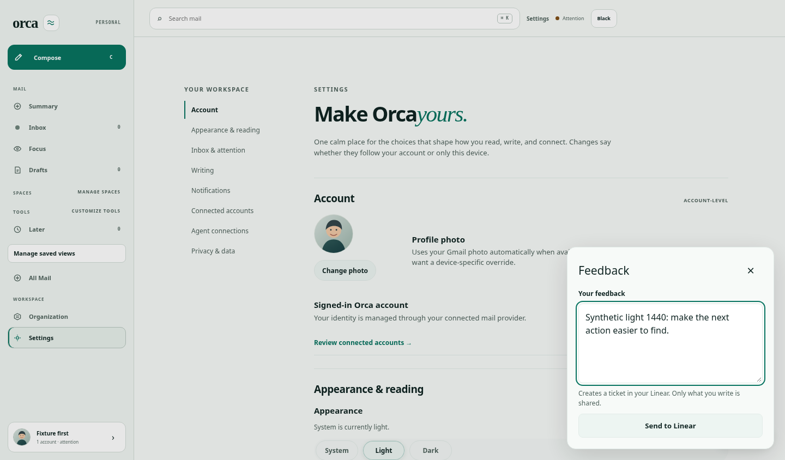

# Corner feedback — BRE-428

[Draft PR #286](https://github.com/lukebrevoort/orca/pull/286) adds a persistent corner button that opens a small, single-message composer. Sending creates a ticket directly in the configured Linear workspace. Linear is the work queue; Orca adds no feedback dashboard, local queue, schema migration, or autonomous coding agent.

The server exposes this personal integration only to the explicitly configured Orca owner. Other users and signed-out sessions have no feedback affordance. Only the entered message is shared; no mail, screenshots, DOM, or account details are captured.

## Review the UI

All screenshots use synthetic data and a stub delivery boundary. No real Linear tickets were created.

| State | Light | Dark |
| --- | --- | --- |
| Persistent corner button | [Desktop](evidence/light-1440-corner.png) | [Desktop](evidence/dark-1440-corner.png) |
| Small message composer | [Desktop](evidence/light-1440-composer.png) | [Desktop](evidence/dark-1440-composer.png) |
| Narrow mobile composer | [320px](evidence/light-320-composer.png) | [320px](evidence/dark-320-composer.png) |
| Sending / disabled controls | [390px](evidence/light-390-sending.png) | [390px](evidence/dark-390-sending.png) |
| Failure keeps the message | [320px](evidence/light-320-failure.png) | [320px](evidence/dark-320-failure.png) |
| Confirmed ticket link | [Desktop](evidence/light-1440-sent.png) | [320px](evidence/dark-320-sent.png) |



## Verification

[Browser results](evidence/results.json) exercise the production web bundle and authenticated API with an isolated database and synthetic Linear delivery. Six scenarios cover light/dark at 1440, 390, and 320 pixels:

- Corner entry, one message field, no title/category form or queue.
- Keyboard opening, visible focus, focus containment, Escape dismissal and restored trigger focus.
- Closing and reopening preserves the current draft.
- Failed delivery produces no false receipt or ticket link.
- Rapid double-click sends once. Losing the response after creation retains the original request ID; retry confirms the same ticket without duplication.
- Confirmed success links to the exact synthetic work record.
- Other-user and anonymous sessions have no affordance; the corner also remains available on the inbox route.

The final run passed on clean commit `0085ffbcf8a2e003f07bf76a28ef951529f95470` with zero page errors using system Chromium 154.0.8037.57. [Build log](evidence/build.log) and [bundle SHA-256 manifest](evidence/bundle-sha256.json) identify the production files exercised. [Lint](evidence/lint.log) passed all workspaces; build also runs their TypeScript checks. Main entry JavaScript is 496.60 kB; the corner component loads separately at 4.36 kB. Final desktop composer, mobile failure/sending/receipt screenshots were visually inspected for readable controls and viewport fit.

Local full-suite results on that source were **2,095 passes and one failure**: API 1,077 pass/1 fail, shared 187 pass, web 831 pass. The failure was the unchanged Gmail sync coordinator multiprocess timing test; its complete file subsequently [passed unchanged in isolation](evidence/sync-isolated.log), 12 tests in 3.99 seconds. The normal full run remains a failure, not a clean pass. The focused feedback tests passed separately; current hosted checks remain the merge gate. Native execution belongs to hosted macOS/Xcode; these browser results do not certify native behavior or a real provider connection.

Reproduce with frozen dependencies and an installed browser:

```sh
bun install --frozen-lockfile
bun run build
ORCA_CHROMIUM_EXECUTABLE=/usr/bin/chromium bash scripts/ci/feedback-ticket-check.sh /tmp/orca-feedback-ticket-new-evidence
python3 scripts/ci/test-export-evidence.py
```

The runner binds loopback, removes provider credentials, seeds synthetic users, injects delivery, and cleans its own process and disposable database. No `.env`, live database, browser profile, or credentials are copied. The native exporter recognizes `FeedbackTicketTests` and `test38FeedbackCornerCreatesLinearTicket` without publishing fixture tokens.

## Behavior and rollout limits

- The owner identifier must be configured server-side along with the existing Linear delivery credentials/destination. Missing configuration fails closed. This PR does not alter production configuration.
- Linear is the durable record. Orca returns success only after a validated Linear receipt. Exact retries derive the same issue identity across server restarts.
- Pending text stays in browser memory; close/reopen preserves it and navigation warns while unsent. This is not offline or process-restart draft storage.
- No merge, deployment, production migration, release, or TestFlight action is included.

## Diagnostic history

The initial dashboard/queue interpretation was superseded by the user's explicit corner-composer correction. Its screenshots and verification artifacts were removed to prevent stale evidence being mistaken for this product.

Earlier browser work exposed a cross-document transition opt-in race: external CSS produced empty-stack `ViewTransition opt-in disabled` errors. The same navigation probe passed with the existing opt-in rule in the initial HTML head ([before](evidence/transition-ready.json), [after](evidence/transition-inline.json)). The retained fix moves that rule early without suppressing errors. The new corner-flow matrix also passes the unchanged browser-error assertion.
