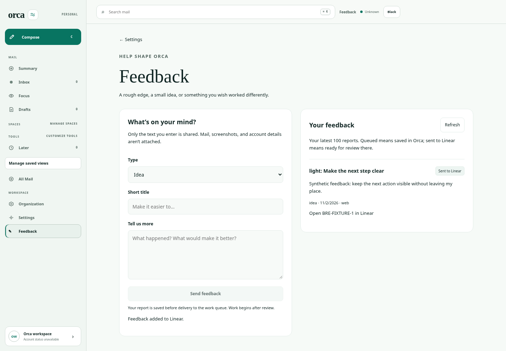

# In-app feedback — BRE-428

[Draft PR #286](https://github.com/lukebrevoort/orca/pull/286) adds production web and native iOS feedback capture. The existing development widget remains available. The app saves each authenticated user's text to SQLite before attempting the existing configured Linear destination. Failed or unavailable delivery leaves a durable queued report with an explicit retry action. Work begins after review; no autonomous coding agent is introduced.

## Review the UI

All images are synthetic. Source: `96849fdaf63c271f34d078d03069584d3037c3a2`, with a clean checkout. Browser: system Chromium 154.0.8037.57, not the pinned Playwright download. Main entry bundle is 497.23 kB; feedback loads separately at 6.99 kB.

| State | Light | Dark |
| --- | --- | --- |
| Form and keyboard focus | [Desktop](evidence/light-desktop-focus.png) | [Desktop](evidence/dark-desktop-focus.png) |
| Hover | [Desktop](evidence/light-desktop-hover.png) | [Desktop](evidence/dark-desktop-hover.png) |
| Saving and disabled controls | [Desktop](evidence/light-desktop-saving.png) | [Desktop](evidence/dark-desktop-saving.png) |
| Lost response, retry same report | [Desktop](evidence/light-desktop-uncertain.png) | [Desktop](evidence/dark-desktop-uncertain.png) |
| Durable queued report | [Desktop](evidence/light-desktop-queued.png) | [Desktop](evidence/dark-desktop-queued.png) |
| Linked Linear work record | [Desktop](evidence/light-desktop-delivered.png) | [Desktop](evidence/dark-desktop-delivered.png) |
| Mobile queue, actual 320px viewport | [Mobile](evidence/light-320-queue-viewport.png) | [Mobile](evidence/dark-320-queue-viewport.png) |
| Mobile navigation | [390px](evidence/light-390-navigation.png) | [390px](evidence/dark-390-navigation.png) |



## Verification

- [Final browser results](evidence/results.json): production bundle + real authenticated API + fresh migrated SQLite; both themes, desktop 1440 and mobile 390/320; persistence after reload, ownership, double-click prevention, lost-response stable ID, delivery failure/retry, work link, loading/error/recovery, navigation, and mobile submission. Zero page errors. Delivery boundary is synthetic; no live Linear request. Additional [viewport metadata](evidence/viewport-captures.json).
- [Final build](evidence/build.log) passes all workspaces. [Bundle hashes](evidence/bundle-sha256.json) identify the files used for the final browser run. [Lint](evidence/lint.log) and all-workspace typecheck passed before the final HTML/CSS/link-copy correction; final build includes TypeScript checks.
- 1,076 API and 187 shared tests passed; backend remained unchanged after those runs. 63 focused feedback/legacy tests passed. An independent review additionally ran 14 queue/Linear tests, 40 assertions, zero failures.
- Initial web suite exposed static-render access to `window`, a newly added mobile menu label, and delayed download timers leaking into another test's URL mock. Fixed the guard, updated the navigation expectation, and made each attachment test own its delayed release timers. Product download behavior and test assertions were preserved. Two unrelated fetch-quiescence failures passed unchanged in isolation. A later full run passed 830/831, with the unrelated 500-row formatter test hitting the local 5s default; that test passed unchanged alone in 2.13s. Final full-suite and hosted results are recorded on the PR.
- Native: five XCTest cases and `test38FeedbackQueuesAndSurvivesRelaunch` are included, selected in both light/dark hosted compose runs. The mobile fixture explicitly disables Linear. Native tests require hosted macOS/Xcode; Linux supplied no native compilation or screenshot claim. Consult the PR's checks and artifacts for results.
- Independent reviewer `/root/feedback_review` reviewed base `2a56e488aa4a47c24846448c648a4d9cbe088590` through `96849fdaf63c271f34d078d03069584d3037c3a2`: no blocking source findings. This is an independent agent review, not a multi-model claim.

Earlier browser attempts are retained as failed results in `evidence/failed-browser-attempt*.json`. They passed their feedback assertions but failed the browser-error gate. The cause was the cross-document transition opt-in arriving in external CSS. The same three-navigation probe failed with external CSS and passed with early inline opt-in; [before](evidence/transition-ready.json) / [after](evidence/transition-inline.json). The production fix moves the existing rule into initial HTML, without suppressing errors. Final unchanged harness passes after rebuilding that committed fix. This follows [Chrome's critical-style guidance](https://developer.chrome.com/docs/modern-web-guidance/guides/ui-behaviors/consistent-cross-document-transitions).

Reproduce from this branch with frozen dependencies and the installed browser:

```sh
bun install --frozen-lockfile
bun run build
bun test apps/api/src/feedback-queue.test.ts apps/api/src/integrations/linear.test.ts
ORCA_CHROMIUM_EXECUTABLE=/usr/bin/chromium bash scripts/ci/feedback-queue-check.sh /tmp/orca-feedback-new-evidence
```

The fixture binds loopback, removes provider credentials, owns a fresh temporary database and injects delivery. Its runner stops only its owned process and deletes only owned scratch. Source and screenshot evidence remain. It does not copy `.env`, mail databases or browser profiles.

## Contract and deliberate limits

- Cookie and mobile bearer authentication; browser mutation origin guard; composite `(user_id, id)` report identity; transactional duplicate/payload conflict handling.
- 64 KiB request bound; 200-character title and 10,000-character detail; strict surface route allowlist. No automatic mail, screenshot, DOM, account address or query-string capture.
- New server-generated Linear issue UUID persisted before delivery; retry reconciles that exact UUID. Delivery timeout is 12s, lease 60s, cooldown 30s. Real provider behavior remains untested in this task.
- Queue displays newest 100 reports; storage caps at 1,000 per user. Older reports remain durable but aren't exposed for UI retry beyond the latest 100. There is no pagination, deletion or synchronized Linear completion state in this minimum flow.
- Browser pending text stays in page memory and navigation warns while it is unsent; it is not an offline persisted draft. Native pending text survives navigation within Settings but not process termination. Saved reports survive both.
- `LINEAR_API_KEY` and existing destination configuration are reused when available. Missing configuration leaves reports saved in Orca. Delivery is attempted on submission and explicit retry; no background delivery worker or autonomous implementation agent.

## Remaining release steps

This branch is a draft proposal, not a production change. Main is deployment-linked. Before approval to land: review all final CI results and native screenshots, confirm the intended Linear destination/available secret without exposing it, review and back up the production database, approve additive migration `0052_feedback_queue`, and coordinate API-before-web/native rollout. Existing API startup executes migrations, so merging is not an isolated code-only action. No production migration, merge, deployment, credential change or TestFlight release was performed here.
