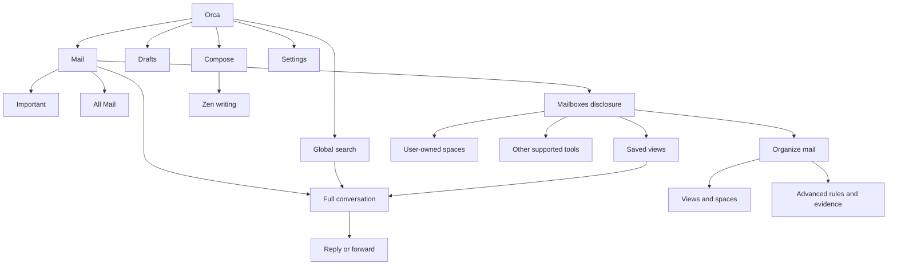

# Orca foundation information architecture

Status: proposed architecture grounded in the current surface inventory. Product choices below are recommendations to evaluate, not historical approvals. Application implementation starts after the four current audit tickets merge.

Baseline: `9ec3ca31afecc28a4af2bf8b40c48a5f1fb9a311`. Source-only maps independently inspected web/API and native iOS; no fresh product execution is claimed by this inventory.

## Primary hierarchy

Recommended option A is an importance-first Mail surface with a permanently reachable All Mail switch. Drafts stays a primary anchor. Search and Compose remain global. Saved views and user-owned spaces are available through a compact Mailboxes disclosure; Settings and advanced organization remain readily reachable utilities.

Option B uses the same hierarchy but opens the full Inbox first, with an Important filter beside it. This reduces onboarding surprise but exposes more competing mail on entry. Neither option equates read state, Human Signal, placement or saved views with importance.

The exact initial filter is an open product choice. Both options must preserve existing deep links, account isolation, custom names/order and source-list/search return context. All Mail recovery cannot be hidden by a preference that removes its only entry.

## Surface inventory

Pages and overlays are listed separately so a count cannot hide unimplemented journeys. Existing routes may remain compatibility aliases even when default entry points change.

| ID | Surface | Platform | Type | Entry and purpose |
| --- | --- | --- | --- | --- |
| P01 | Mail / Important / All Mail | Web + iOS | List | Primary app entry; importance filtering and full recovery are distinct from placement. |
| P02 | Mailboxes and saved-view results | Web + iOS | List/disclosure | Named user-owned spaces, collections and saved views; preserve configured order and visibility. |
| P03 | Full conversation reader | Web + iOS | Detail | Open from any mail list/search/push with return context, complete content and relevant actions. |
| P04 | Drafts | Web + iOS | List | Primary anchor; saved/recoverable writing and honest failures. |
| P05 | Compose and inline reply/forward | Web + iOS | Form | Global Compose or conversation action; shared durable draft semantics. |
| P06 | Zen writing | Web | Form/presentation | Alternate writing presentation sharing recipients, body, attachments and delivery state. |
| P07 | Search and results | Web + iOS | Search | Global/contextual search with account scope and reader return context. |
| P08 | Saved-view creation/editing | Web + iOS supported journeys | Form/preview | Search or selected senders, real read-only preview, labeled refinement and explicit save. Platform parity must be specified rather than inferred. |
| P09 | Manage views and spaces | Web + iOS supported journeys | Management | Existing names/order/visibility and recovery; advanced authoring is optional. |
| P10 | Advanced Organization | Web | Editor | Existing rules, lanes, Glass Box/Tide Table, simulation, apply/revert and contextual evidence; retained behind a clear advanced entry. |
| P11 | Settings | Web + iOS | Settings | Account, appearance/reading, writing, notifications, connections and privacy. Web's eight sections remain directly reachable. |
| P12 | Provider connection settings | Web | Settings | Gmail permissions/labels, Calendar scope and existing provider flows; keep access and failure explanations available. |
| P13 | Authentication / onboarding / native handoff | Web + iOS | Auth/onboarding | Existing session gates and provider consent; concise orientation to importance, full mail and safe correction. |
| P14 | Later and manual reminders | Web; preserve native supported behavior | List/editor | User-chosen return time and Done/Cancel/Snooze remain distinct from automatic reply suggestions. |
| P15 | Summary / reply-review tools | Web | Optional hub | Coordinate BRE-438; only real account-scoped capabilities or honest unavailable states. |
| P16 | Reading and mailbox preferences | Web + iOS | Settings | Existing dedicated reading/attention-view routes and native mailbox choices; essential recovery stays reachable. |

## Overlay and operational-state inventory

| ID | State family | Required preservation |
| --- | --- | --- |
| S01 | Importance choice | Explicit local scope, broader effects only through a separate explicit choice; pending/conflict/failure/correction semantics. |
| S02 | Move mail / bulk move | Existing conversation/sender scope, account ownership and revision protection; separate name and consequence from importance. |
| S03 | Sender selection / view growth | Create or refine a view without creating a temporary saved view or changing placement. |
| S04 | Navigation and authoring guards | Unsaved settings/views, safe Stay/Leave, modal ownership, settled focus and interrupted navigation. |
| S05 | Draft conflict/recovery/permission | Current writing preserved, pending/uncertain delivery truthful, permission boundaries and repeated dispatch safe. |
| S06 | Reader controls and content recovery | Details/quotes/history, original formatted/plain content, images/attachments, long-thread and oversized-message recovery. |
| S07 | Account/sync/offline state | Reconnect, stale results/cursors, missing account/space/view, authority recovery and honest retry paths. |
| S08 | Notifications and reminders | Permission/device availability, eligibility and quiet behavior; distinguish immediate OS delivery from in-app resurfacing. |
| S09 | Trace/audit/simulation | Deeper evidence remains contextual and optional; no new authority or silent provider change. |
| S10 | Feedback and global utilities | Remain reachable without covering content/actions, across viewport/Dynamic Type and top-layer changes. |

This inventory contains 16 surface families and 10 cross-cutting state families. It is a coverage inventory, not 26 independent routes or an implementation completion count.

## Current implementation and compatibility map

- Web has pathname dispatch in `App.tsx`, then URL-backed shell states in `navigation.ts` and `surface-history.ts`; it has no React Router registry. Preserve supported destination, thread/account, compose/draft/Zen and search deep links.
- Current web navigation exposes Summary, Inbox, Focus, Drafts, Spaces, Tools, All Mail, Organization and Settings. The proposal reduces default exposure without deleting user-owned spaces or changing their placement meaning.
- Native currently has Inbox, Drafts and Settings tabs with a mailbox menu. Keep the small primary structure; add clear importance access and guarantee full-mail recovery rather than copy the desktop sidebar.
- Web `SenderAttentionControl` currently opens `RoutingChooser` / “Move to space,” writing `/v1/destinations/routing`. Native has no importance writer. A direct importance action therefore requires a real shared contract; relabeling Move is insufficient.
- Legacy attention values drive badges and unread promotion. Authorship, proposal-only notification intent and actual APNs placement-based eligibility are separate systems. Their migration/compatibility behavior must be explicit in the next phase.
- Native search currently disables itself inside saved views; the scope and escape path must stay understandable. Native simple view creation starts from a selected sender, while web also supports search-based creation.
- Native oversized recovery explicitly lacks full recipients/attachments/reply. Keep that limitation visible while improving the ordinary full reader.

Source maps: web dispatch `App.tsx:415`, navigation `navigation.ts:80`, reader/compose state `surface-history.ts:32`, search `global-search.tsx:90`, authoring `organization-views.tsx:1038`, advanced studio `desktop-switch.tsx:865`; native `OrcaApp.swift:56`, `InboxView.swift:168`, `MailboxViews.swift:29`, `ThreadView.swift:24`, `MailActions.swift:44`, `NotificationManager.swift:97`. These line pointers refer to the pinned baseline above.

## Global component responsibilities

Mail navigation, account selector, search, Compose, sync/recovery status, theme/text preferences and the shared modal/focus contract remain global responsibilities. Importance choice, Move and saved-view actions are contextual and must not acquire each other's side effects. Component APIs and visual values are specified in later phases.

## Architecture verification

The inventory accounts for all observed production surface families, dedicated settings subpages, supported deep links and cross-cutting overlays. Development previews and static validation documents are verification/support artifacts rather than primary application pages. No capability is marked shipped or removed by this architecture. The seven decision groups in `requirements.json` remain open until their adopted contracts are recorded.
