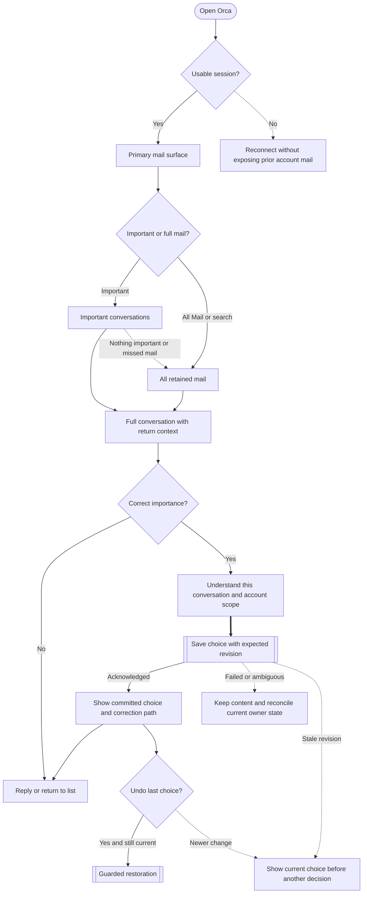
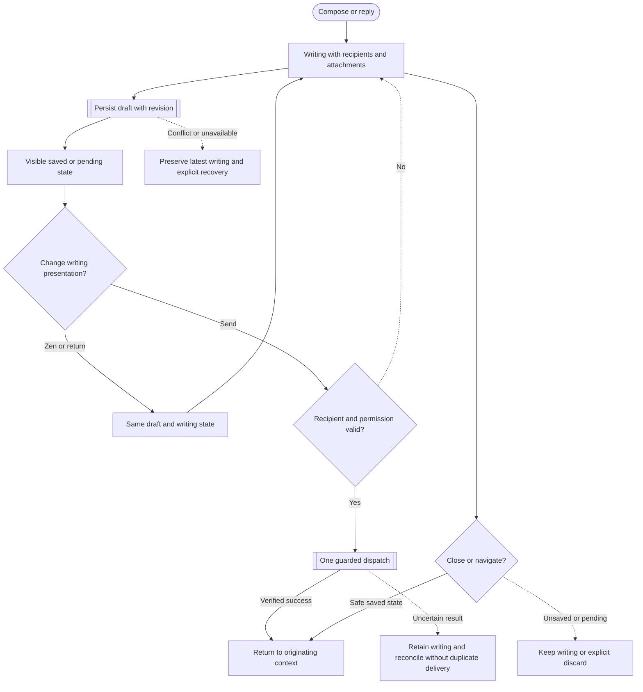
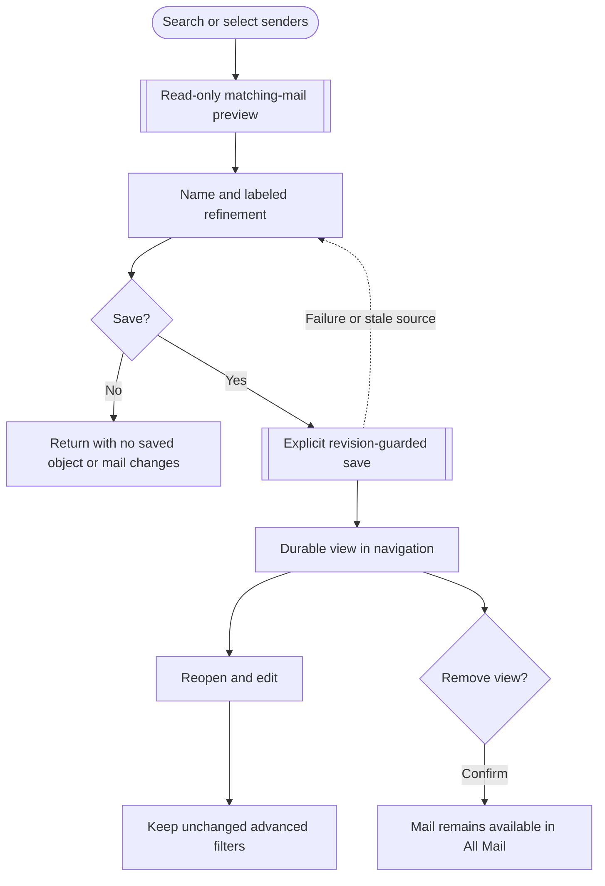
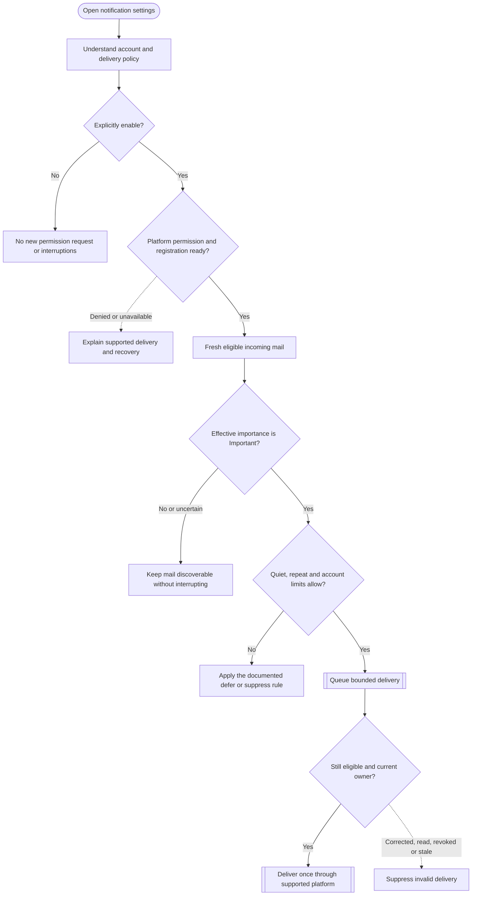
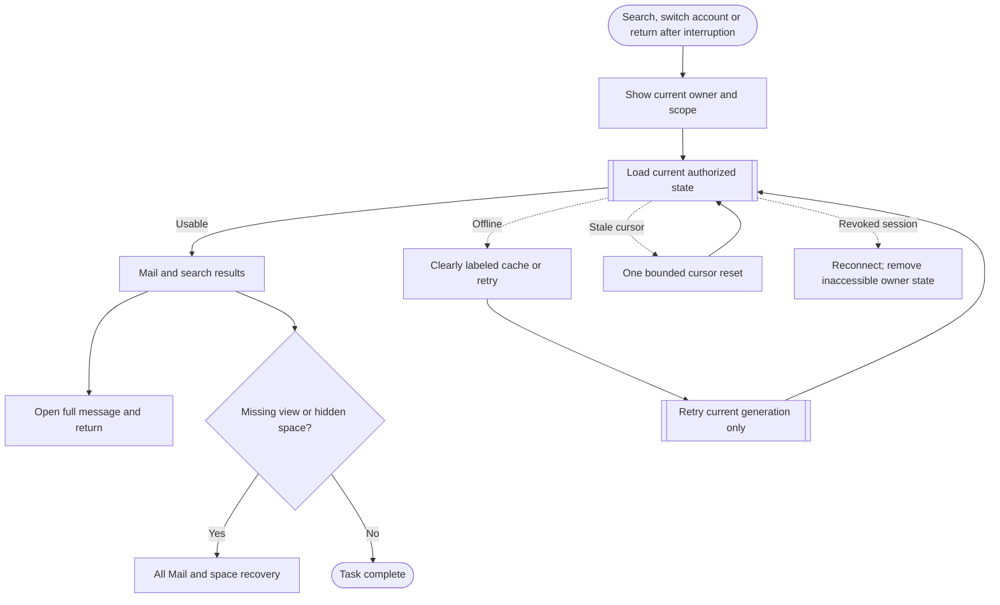

# Orca foundation journeys

Status: proposed interaction contracts for review, grounded in phases 1–2 and `requirements.json`. No implementation or performance result is claimed. Primary entry A/B and the seven open decision groups remain explicit proposals until adopted.

## F01 — Notice, read, correct and recover

| Step | User action | Observable response | Error or edge handling |
| --- | --- | --- | --- |
| 1 | Open primary Mail | Show selected entry/filter, account scope and honest loading/empty state. | Revoked/switched sessions never show another owner's cached mail. |
| 2 | Open a conversation | Show complete content with clear return context. | Loading/error/oversized recovery stays explicit; no silent snippet substitution. |
| 3 | Choose Important or Not important | State the conversation/account scope and show pending feedback. | No provider move, read-state change, sender rule or notification permission is silently created. |
| 4 | Await save | Only acknowledged state is presented as committed; filtered removal preserves keyboard/focus context. | A failed/ambiguous response preserves content and reconciles server state; stale operations cannot overwrite a newer choice. |
| 5 | Correct or undo | Direct correction remains available after reload. Guarded immediate Undo only restores the version it owns. | Do not claim a general durable undo history unless implemented. |
| 6 | Find missed mail | All Mail/search stays directly reachable even when Important is empty. | Unknown or Not important mail is retained and searchable. |

Importance scope recommendation: conversation in one connected account. Future messages in that same conversation follow its explicit choice. Any offered sender/future-conversation choice is a separate consent step with exact consequences, preview and account identity; it cannot reuse Move mail under a new label. Human authorship and unread status remain different properties. Whether sender propagation is included is recorded in the adopted decision contract before implementation.

## F02 — Write and deliver without losing work

| Step | User action | Observable response | Error or edge handling |
| --- | --- | --- | --- |
| 1 | Compose/reply/forward | Use the correct account and intent, saved writing defaults and original context. | Permission and account readiness are explicit; stale results cannot replace a newer owner. |
| 2 | Edit recipients/body/attachments | Recognizable controls and truthful pending/saved state. | Latest writing survives failed/stale saves and attachment operations. |
| 3 | Open/leave Zen | Preserve the same content and pending recipients; actions and attachment/status regions do not overlap. | Escape, repeated transitions and interrupted persistence retain the draft. |
| 4 | Send | Validate pending recipient text, then dispatch once with independent delivery evidence. | Double clicks/replays cannot cause a second provider invocation; uncertain results retain recoverable writing. |
| 5 | Close/return | Return to originating conversation/list with usable focus. | Explicit discard owns its draft cleanup; account changes clear inaccessible surfaces. |

Existing synthetic compose and native fixture suites are mandatory preservation evidence; they are not substitutes for the new importance or navigation journeys.

## F03 — Group useful mail without changing it

| Step | User action | Observable response | Error or edge handling |
| --- | --- | --- | --- |
| 1 | Search or select known senders | Show the actual selected scope/account/filter. | Native/web entry parity is specified explicitly; unavailable paths are not represented as working. |
| 2 | Preview and refine | Real matches, honest partial counts and precise positive-sender restriction labels. | Preview creates nothing and has no provider/notification side effects. |
| 3 | Save explicitly | Persist name, filter, order and navigation entry. | Retry/stale source handling does not duplicate or silently widen the view. |
| 4 | Reopen/edit | Preserve advanced filters on unchanged edits. | Unsaved changes require a safe Stay/Leave decision. |
| 5 | Remove | Remove only the view after confirmation. | Underlying mail, provider placement and notification policy stay intact. |

## F04 — Interrupt only for the chosen meaning of important

| Step | User action/system event | Observable response | Error or edge handling |
| --- | --- | --- | --- |
| 1 | Inspect/enable policy | State the account, Important-only meaning and actual supported delivery conditions. | A saved view or Move action never grants interruption authority. |
| 2 | Grant or deny permission | Register only after explicit intent; show denied/unavailable states truthfully. | Client/OS constraints are not reported as successful delivery. |
| 3 | Receive mail | Evaluate importance independently from authorship/placement. | Uncertain and Not important mail remains in All Mail/search without interruption. |
| 4 | Queue/deliver | Apply adopted freshness, quiet, batching and repeat bounds, then recheck current account/session/preferences/importance. | Corrections and revocation suppress ineligible queued work; retries do not duplicate deliveries. |
| 5 | Correct a false positive | Update the explicit importance choice and its documented queued/future effects. | Marking old mail important must not create a backlog notification storm. |

The policy still requires adopted values for eligibility, uncertainty, batching, quiet behavior, repeat limits and compatibility with existing location-based native settings. Source inspection found proposal-only attention preferences, placement-based APNs and no implemented web reminder Notification API. None is proof that this proposed loop already exists. Manual reminders remain a separate chosen return-time feature.

## F05 — Find mail and recover trustworthy state

| Step | User action | Observable response | Error or edge handling |
| --- | --- | --- | --- |
| 1 | Change account/search/surface | Show the active scope and retain valid return context. | Abort or ignore earlier generations; reject cross-owner data/actions. |
| 2 | Receive results | Match real query/filters and honest result-count scope. | Offline/stale pagination cannot silently appear complete. |
| 3 | Open/back/forward | Keep reader/list/search context and keyboard focus usable. | Interrupted history changes cannot discard unsaved writing/preferences. |
| 4 | Recover missing organization | Guarantee access to retained mail and restore supported hidden spaces. | A missing view does not mean missing mail; security revocation does not expose another cache. |

## Cross-flow decisions and evidence

The next page specifications must adopt exact choices for primary entry, importance scope, propagation/undo and notification policy. These flows deliberately describe failure, stale-operation and exit behavior before visual styling. Feedback/pending state is immediate; latency/resource claims require paired measurements at pinned revisions rather than invented time estimates. The 33 requirements remain unverified until final application evidence is recorded.
