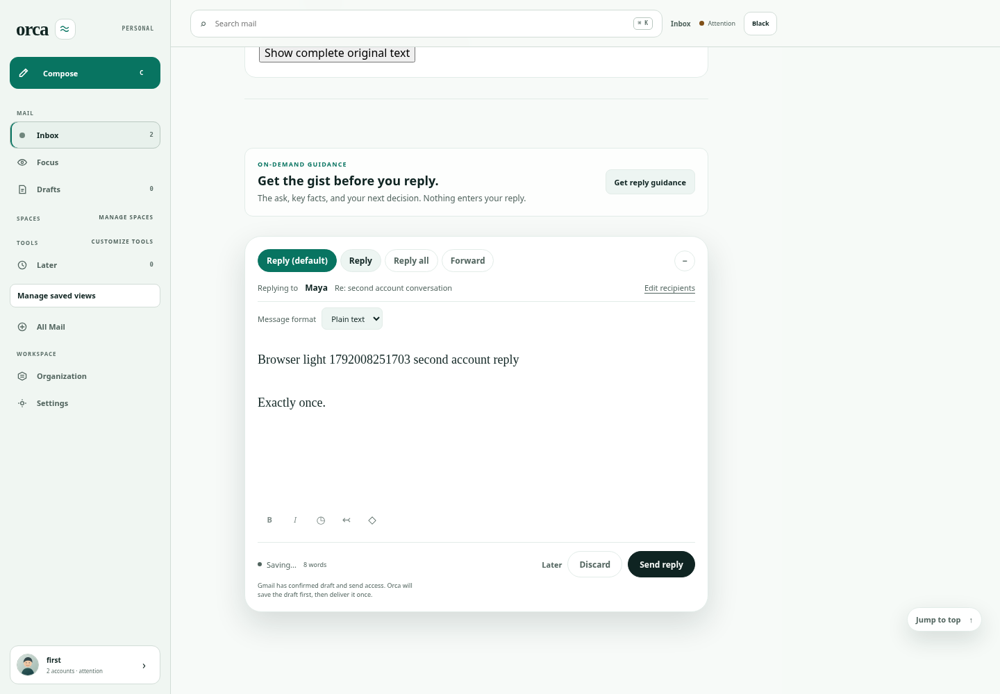
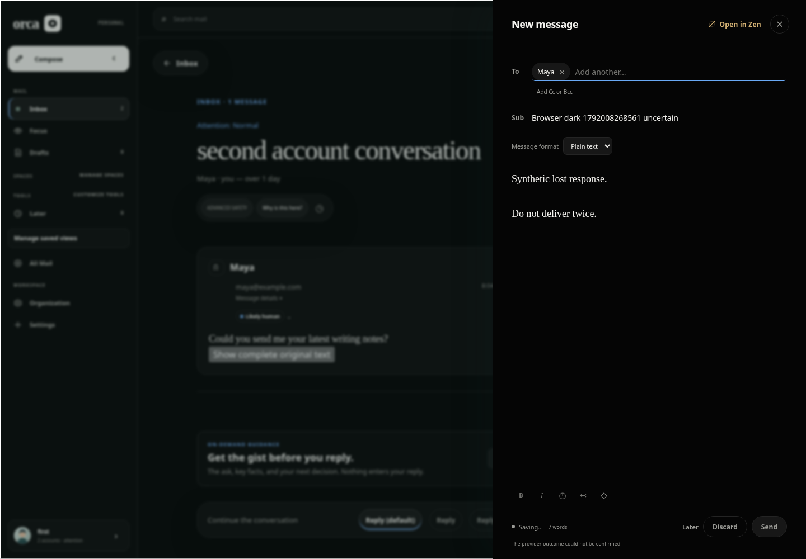

# Executed pstack trial

Tested and independently reviewed source: **149a2777876eb62ad2538344d25455d8baadd0b9**.
Later evidence/documentation commits do not change the executable source. Each
run's manifest records its own tested commit, tree, driver/lock digests and file
hashes. These are consistency checks, not signed execution attestations.

## Successful user journey

[Manifest](success/manifest.json) · [Browser/API results](success/browser-results.json)
· [Build and assertions](success/checks.log) · [Tool identity](success/identity.log).

Executed 2026-10-14: production build, fresh loopback API/SQLite, authenticated
synthetic account doctor, 16 light/dark browser scenarios and 8 provider stub
invocations. Zero page errors. 26 real screenshots remain after owned scratch
and process cleanup. External browser requests (Google Fonts) were blocked.
Fixture providers cannot deliver live mail; product text mentioning Gmail is not
proof of Gmail persistence. Persistence, account scope, recipient/attachment
contents and duplicate-send handling are independently asserted via API/ledger.

| Light: reply from second account | Dark: uncertain delivery preserves writing |
| --- | --- |
|  |  |

Main agent and independent reviewer visually inspected those two screenshots;
the complete [screenshot directory](success/screenshots) contains the other
observed states, not a claim of exhaustive visual review of every control.

## Failure and cleanup

- [Initial actual doctor failure](initial-doctor-failure/checks.log), tested
  `ba5e63f0c0733a3870dda0a064482118a4ab67f0`: the new doctor incorrectly expected
  a user from `/v1/me`, which actually returns the selected mail account. Fixed
  the assertion; the same full browser journey then passed at `106862e` and
  again at `149a277`. The original failure retains its own manifest/exit code.
- [Independent induced failure](induced-failure/checks.log), tested `149a277`:
  `trial --fail-after doctor` completed build, launch and authenticated doctor,
  then exited 1 as intended. `evidence --expect-failure` exited 0. This does not
  turn the failed trial into a product pass. Scratch was removed and associated
  fixture processes were absent; evidence survived.
- Eight runner unit tests pass, covering changed evidence, extra private files,
  wrong SHA, symlinks, missing cleanup, command timeout and a descendant that
  ignores SIGTERM. Four existing evidence exporter/redaction tests also pass.
- The existing exporter scans every exported byte for the ephemeral session
  credential and fails closed. Additional retained-text checks found no
  unredacted bearer/cookie pattern; no connection metadata, SQLite, environment
  file, browser profile or raw trace is published.

## Independent review

Reviewer `/root/independent_review` (separate agent using the same model; no
multi-model claim) reviewed the full integration for safety, correctness,
maintainability and honest evidence at `106862e` and `149a277`.

| Finding | Disposition and proof |
| --- | --- |
| Process leader could exit while a TERM-ignoring descendant survived | Fixed with owned-group KILL escalation; behavioral descendant test passes. |
| Absolute dependency cache symlink could point back to author checkout | Internal links rebased into scratch; escaping links rejected before build. |
| Validator trusted arbitrary inventoried filenames | Export allowlist enforced; private-file and tamper tests reject bad evidence. |
| Manifest is not an execution attestation | Explicit limitation in onboarding; no signed-proof claim. |

Final verdict at `149a277`: no remaining blocking findings. Reviewer independently
ran the failed lifecycle and validated the successful artifact set and screenshots.

A second independent reviewer, `/root/final_evidence_review` (same model),
reviewed `149a277`, reran all eight runner tests, independently validated both
artifact sets, checked all 54 skill/23 playbook coverage entries and confirmed
the retained MIT license is byte-identical to upstream. No blockers; corrected
a documentation wording nit about which hosted workflow is path-filtered.

## Reproduce

On a provisioned checkout (see [prerequisites](../README.md)):

```sh
python3 scripts/pstack/verify.py doctor
python3 scripts/pstack/verify.py trial /tmp/orca-pstack-my-trial
python3 scripts/pstack/verify.py evidence /tmp/orca-pstack-my-trial --commit "$(git rev-parse HEAD)"
python3 scripts/pstack/test_verify.py
python3 scripts/ci/test-export-evidence.py
```

This execution environment already supplied Bun 1.3.14, Node 24.19.0,
Python 3.12.14, installed repository dependencies, and system Chromium
154.0.8037.57. The run added `/workspace/.orca-tools/node_modules/.bin` to PATH
and set `ORCA_CHROMIUM_EXECUTABLE=/usr/bin/chromium`. No software was installed.
The default documented route uses the preinstalled locked Playwright browser;
this local run used the explicit system-browser override. Installed dependencies
are reused (not freshly resolved or hermetically attested).

Native checks were **not run locally**. Existing hosted Fixture Checks owns
unsigned iOS unit/compose verification; Native Reader Checks is path-filtered
and this integration does not trigger or claim that lane. No reader runtime,
reader artifacts or search benchmarks were edited. CI status belongs to the
exact linked run/head in the PR, not to these local browser artifacts.
