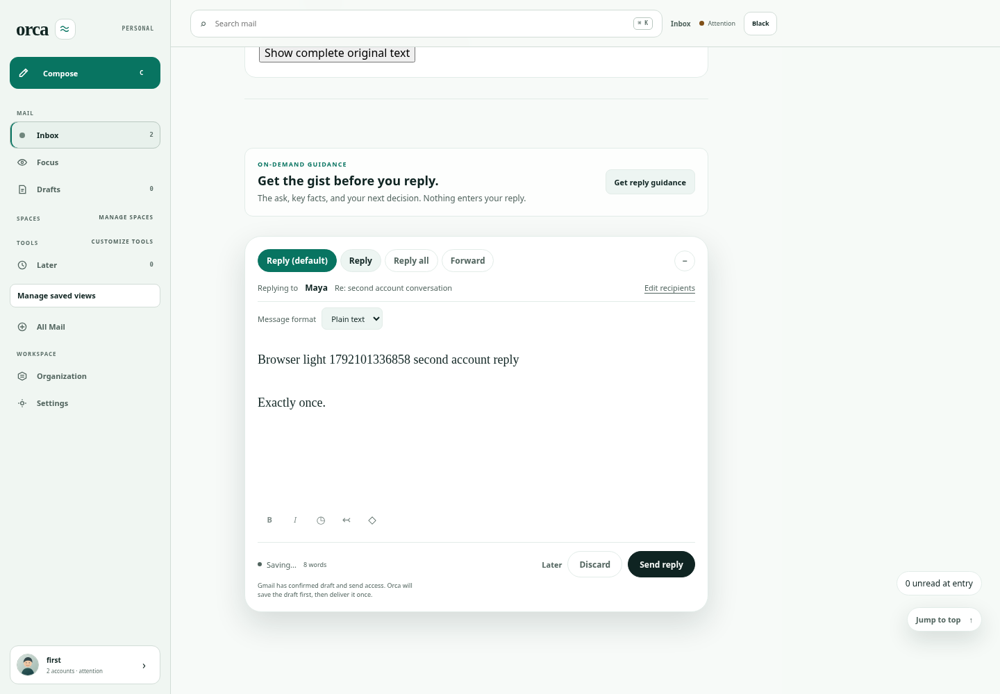
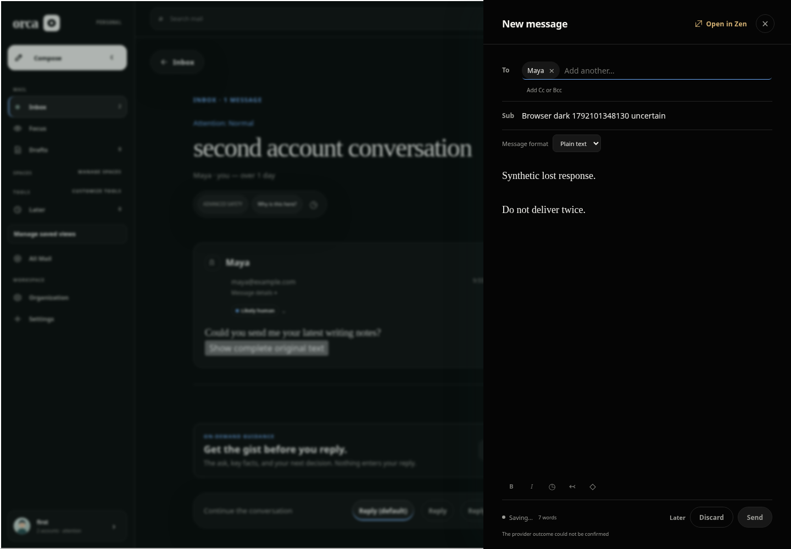

# Saved-cloud integration evidence

This continues [the original #248 evidence](../README.md); nothing replaces or
relabels those historical results. [Gap assessment](../../assessment-2026-10-15.md)
separates existing, missing and unverified capabilities against pinned upstream.

Final executable source: `49e1551b19c08269a34fe59a804a6c41c3c0a55c`, integrating
main `2d104ea394cc319c085d8983d2c17a923c2be467`. A later docs/evidence commit
contains this report; the PR identifies its full head and hosted checks.

## Setup and iteration

`bash scripts/pstack/cloud.sh setup` installed frozen workspace dependencies but
the pinned Chromium CDN returned HTTP403. [Original failure](setup/download-failure.log)
is retained. Explicit `ORCA_CHROMIUM_EXECUTABLE=/usr/bin/chromium` setup and actual
browser launch passed ([setup](setup/system-browser.log), [final doctor](setup/final-doctor.log)).
This image has Bun 1.3.14, Node 24.19.0, Python 3.12.14 and Chromium 154.0.8037.57.
The pinned browser download and cold Bun bootstrap are not claimed exercised.
No shell profile, credential, OAuth, application configuration or database changed.

Independent review reproduced an explicit Bun override whose executable name was
not `bun`: activation succeeded but downstream `bun` was unavailable. The final
script rejects unusable explicit overrides before fallback/install. Preserved
[before](setup/override-before.log) and [after](setup/override-after.log) checks
cover invalid names/paths/versions and valid named symlink activation.

## Independent review

`/root/assess` independently checked upstream intent and the initial gap analysis.
`/root/workflow_review` reviewed `94649278aa95de058221d3eb757e3e59c2e78647`, then
re-reviewed the correction at `49e1551b19c08269a34fe59a804a6c41c3c0a55c`.
Separate agents were used; model diversity is not claimed.

Final verdict: no Act-on or remaining Consider findings. Reviewer independently
passed Bash syntax, whitespace, invalid override rejection for setup/env/doctor,
valid symlink activation, shell-quoting with spaces/quotes/dollar characters and
real Chromium launch doctor. Product trial and hosted results are separate gates.

## Verification

- Eight existing lifecycle/integrity tests passed: [log](runner-tests.log).
- Four existing evidence exporter/redaction tests passed: [log](export-tests.log).
- Final committed-source browser/API trial: [manifest](success/manifest.json),
  [scenario results](success/browser-results.json), [logs](success/checks.log).
- Controlled failure after doctor: [manifest](induced-failure/manifest.json),
  [original log](induced-failure/checks.log). Expected exit 1 is failure evidence,
  not a product pass. Exact-SHA validation and owned cleanup passed for both runs.

The successful run has 16 passed light/dark scenarios, eight synthetic provider
invocations, 26 screenshots and zero page errors. The parent inspected the linked
light account reply and dark uncertain-delivery images for usable content and
labels. No blanket all-state visual or native claim follows from these images.

| Account reply, light | Uncertain delivery retains writing, dark |
| --- | --- |
|  |  |

## Product pilot and handoff

The real pilot uses an isolated branch based on current main: malformed Gmail
timestamps no longer abort batch persistence. It has its own task record, failing
then passing synthetic tests, independent reviewer and draft PR. It does not
bundle workflow code, touch #235 search/performance, or change UI. Its evidence
must be read at its own commit; this compose trial cannot verify date normalization.

At this immutable evidence checkpoint, hosted PR checks and pilot publication are
still being followed. **Live status and final head/check URLs are in the #248 PR
description**, avoiding evidence-only pushes that restart already running CI.
`review-ready` requires those checks to pass; the PR remains draft. No merge,
release, live mail write, production migration or paid infrastructure is authorized.

Limitations: system-browser revision differs from the locked Playwright download;
fresh images must supply Chromium/OS libraries or working CDN access. Dependencies
are frozen-installed then reused, not hermetically attested. Linux runs no native
checks; existing hosted macOS CI remains the native path. CLI GitHub API access is
forbidden here; connected GitHub reads/writes work without credential changes.
