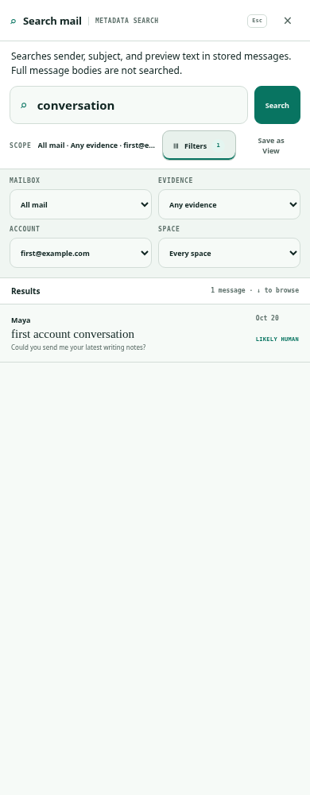
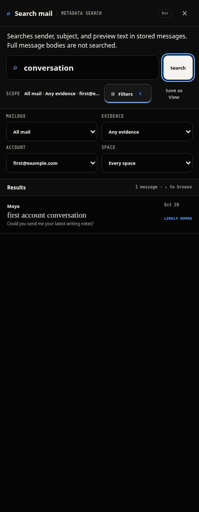

# October 20 current-main integration

**Draft; blocked for production rollout by unresolved performance acceptance and deployment authorization.** This report supersedes older mergeability/current-main statements, not their retained failure evidence.

- Previous PR235 head: `c50466064d85cb9a872079e39ee9879f0a2c9954`.
- Integrated main: `6fa05f9cd6891a58a986fc922ebc4d94b3ac5efe`, already includes PR260/261/263.
- Merge/application commit: `ebead132f4ab0b3ab4f6d270dcccd57f08b5d986`.
- Test-fixture correction: `8fe4160d790fe0c709bf9e7f58fee0a34fda7c42`.
- Final executable/harness commit: `d9f66caf67ffe3a84e26889b9879e9f9ec076b0f`; subsequent publication commit contains documentation/evidence only.

Only two manual conflicts required resolution: retain metadata and image imports in `apps/api/src/index.ts`; preserve main's `grid-template-columns: minmax(0,1fr)` alongside the metadata-coverage row in `desktop-switch.css`. Account-choice, cache, draft, image, touch-control and scheduler improvements remain from main. No obsolete UI fix was reapplied. No new application redesign or performance correction.

## Verification

The first focused run at the merge commit retained **78 passes / 7 failures** in [focused.log](focused.log). Main's newly added account tests mocked legacy responses and exact legacy request URLs; explicit metadata rejects those missing receipts as intended. The correction imports the canonical metadata receipt into that test fixture and updates two exact URL assertions. Account choices, response-order races, scoped results, empty-authoritative lists and stale metadata assertions remain intact. The existing browser harness also receives the explicit mode in its one exact URL assertion.

At `8fe4160`: **85 tests passed, zero failed, 471 assertions across nine files**, all workspace typechecks and production build passed. [Focused log](focused-final.log), [typecheck](typecheck.log), [build](build.log). Tests cover search/account UI, shared schemas, mailbox/search contracts, DB durability, provider draft recovery and normalization/persistence. The requested auth middleware test path does not exist; no standalone auth-test pass is claimed. Search-contract tests exercise authentication/ownership boundaries. Production files are identical between `8fe4160` and `d9f66ca`; the latter changes only the browser harness assertion. Build asset hashes are in [build-assets.json](build-assets.json).

At `d9f66ca`, the existing synthetic search browser harness passed **12 scenarios**, zero assertion failures and zero page errors. [Raw results](browser/results.json). Light/dark at320/390/760/1024/1440px plus320px long account names. Direct account switching, scoped request URL/results, region/control bounds, Tab traversal/focused visibility and empty-search disabled Save as View are asserted. Chromium154.0.8037.57, fresh profiles, authenticated loopback fixture with two synthetic accounts; provider boundary stubbed. Google Fonts blocked, so fallback fonts. Source SHA is operator-supplied; clean committed application source and build hashes substantiate it. This is not native, performance, before/after pixel parity or representative Railway validation.

Root visually inspected all eight retained390px light/dark filtered, hover, keyboard-focus and disabled-state images, plus320px long-account and1440px dark filtered images retained locally. Controls and coverage remain readable. Browser matrix logs and full48-image set remain `/workspace/pr235-evidence/oct20/browser`; this report commits the8representative390px images and all scenario measurements.

| Light selected account | Dark keyboard focus |
| --- | --- |
|  |  |

## Independent review and limits

Reviewer `/root/independent_review` inspected immutable merge and follow-up commits through `d9f66ca`. No blocking source issue: both conflict resolutions preserve current improvements; metadata/FULL behavior remains unchanged. No model-diversity claim. Reviewer also checked the proposed staging/rollout plan; its requested wording correction makes clear that the patch specification is prepared offline and platform staging occurs only after authorization. Reviewer did not independently run the browser matrix or performance workload.

No new performance benchmark, staging spend, production operation, live mail, credentials change or Mac access. The owned loopback fixture stopped and removed its synthetic database; browser contexts closed. Frozen dependency install used `--ignore-scripts`. Full workspace/unit/native validation is delegated to the ordinary automatic PR checks after this single publication push; pending is not green. Final hosted status is recorded in the PR comment without a redundant evidence-only CI push.

Historical Railway relative-p95 failure and later diagnostic limitations remain unresolved. See [October16 evidence](https://github.com/lukebrevoort/orca/pull/235#issuecomment-6222985606). Separate [decision plan](decision-plan.md) proposes a bounded one-shot staging envelope and controlled API-before-web rollout; neither is approved or executed. In particular, merging today independently triggers API/web production deployments and does not ensure API-first order.
