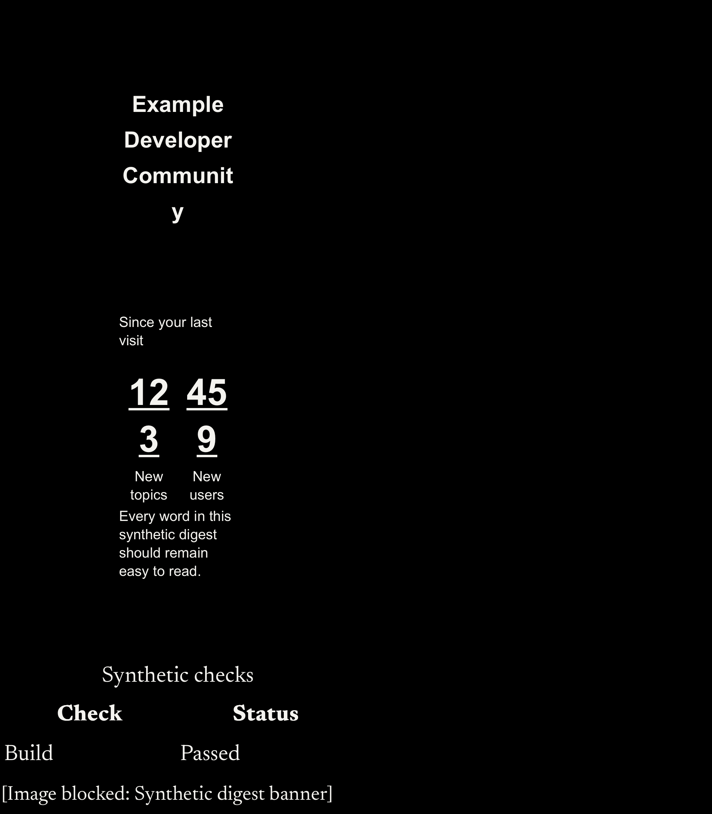
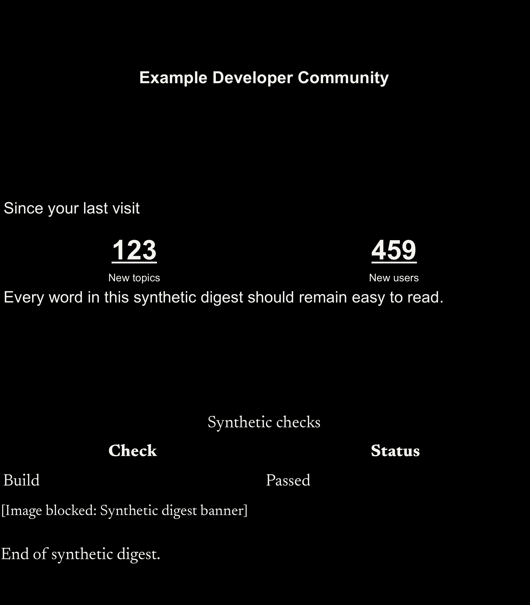

# Native digest width component demo

These selected synthetic body-harness captures were downloaded from the original failing and corrected hosted runs, SHA-256 checked and visually inspected by the integration coordinator. They illustrate the scoped width fix; fresh integration checks remain a separate gate recorded in the PR.

| Baseline | Corrected component |
| --- | --- |
|  |  |

Both unaltered captures use a 700px reader, dark theme and 22px body setting. The title changes from four lines to one; statistics stop wrapping. Retained spacer heights still leave vertical whitespace. This is a WKWebView body harness, not a full-screen conversation or physical-device demonstration.

Parsed `checks.log` measurements cover 12 digest layouts per revision: 272/342/700px × light/dark × body setting 22/44. Title widths change from 42/54/113px to 256/326/680px; title lines change from 10/8/4 to 2/2/1. Corrected body widths are 260/330/688px. No speedup or Dynamic Type scaling claim follows from those layout measurements. The exact identity logs, archive hashes and parsed measurements are retained in [component-metrics.json](component-metrics.json).

- Baseline: `647b1493e5e7f96e56bf16c6d75381358767f177`, [failing hosted run](https://github.com/lukebrevoort/orca/actions/runs/42387346546), artifact `native-reading-42387346546-1`, `screenshots/Orca-82.png`.
- Corrected component: `707e012c7f977730badaa06912d6d8f13f4d0668`, [hosted run](https://github.com/lukebrevoort/orca/actions/runs/42640000620), artifact `native-reading-42640000620-1`, `screenshots/Orca-75.png`.
- PNG hashes: baseline `6ad16818722ea3efbe46583a599693897fa0e63bb07e1af7b07f4799cf330a8c`; corrected `67c208f12e1a7dfce39e0eb6abb3685d92f90c11f393244f87f2c7ae7985dc1b`.

Automatic Native Reader Checks exercise the final PR head. To reproduce in an appropriately provisioned clean Apple checkout without local credentials, use `ORCA_CI_UI_TEST_SCOPE=reading bash scripts/ci/fixture-check.sh ios`; the existing harness creates and cleans its own simulator. Prefer the already-triggered hosted run rather than dispatching duplicates. Read its identity, outcome, complete expected cases, metrics and screenshots before claiming success. The original detailed failed experiments and privacy/semantic exclusions remain in [the task record](../../pstack/tasks/bre-444-native-digest-width.md).
