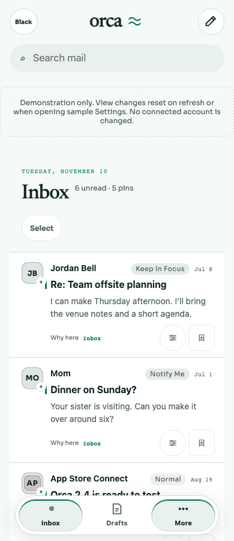
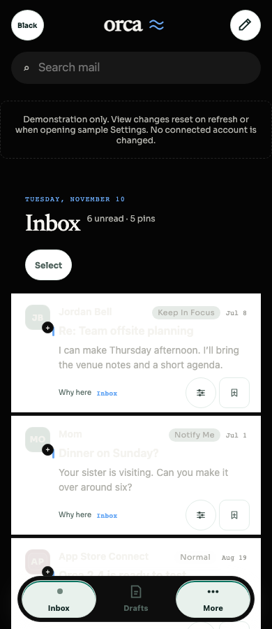
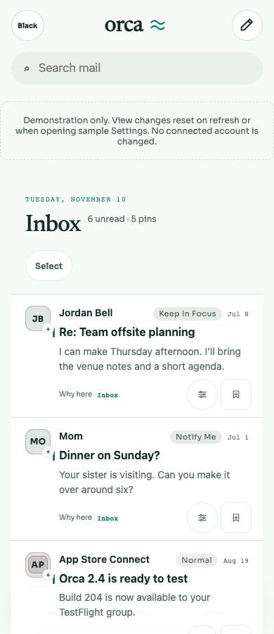
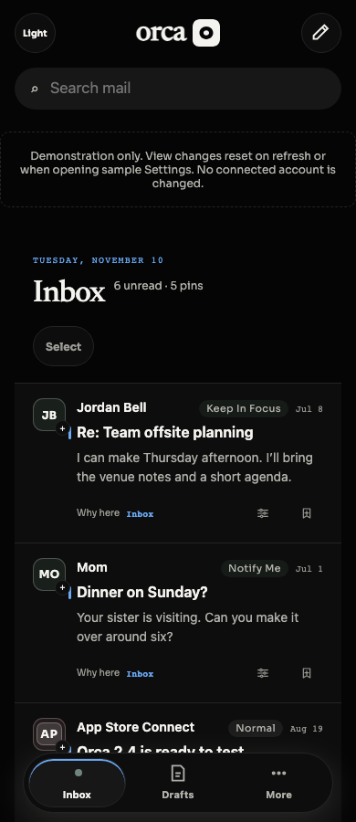
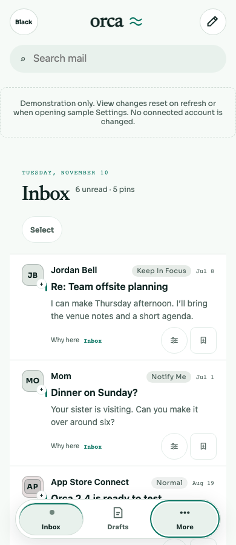
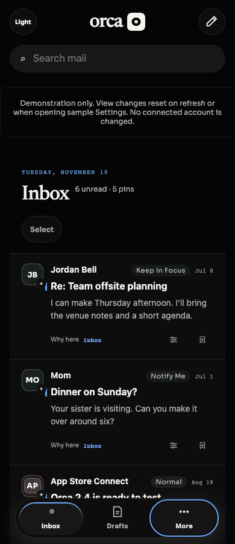
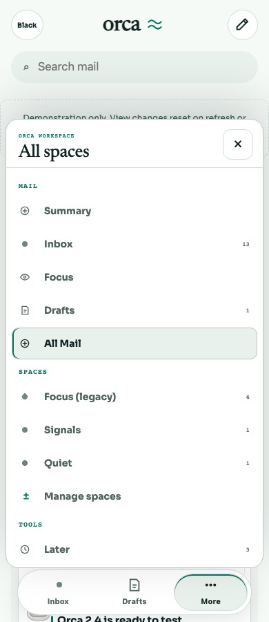
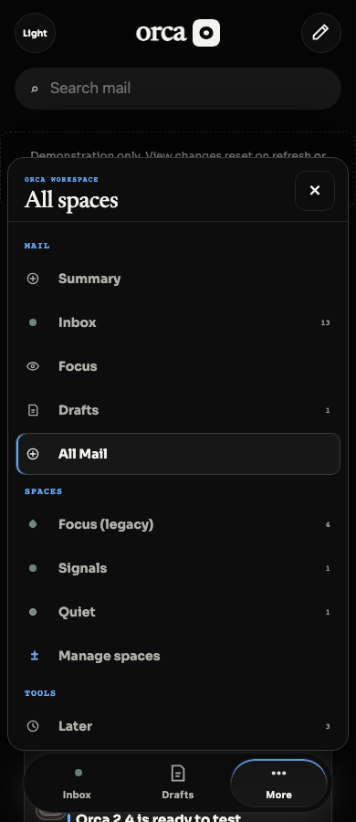

# BRE-449 — mobile navigation current state

Status: implementation complete; independent parent review and final gate pending.
Base: `9ec3ca31afecc28a4af2bf8b40c48a5f1fb9a311` (unchanged).

Inbox's canonical fallback destination alias already selected its stable anchor,
but More classified every `destination:*` value as its own location. This gave
Inbox two current markers and exposed routing IDs in More's accessible name.
More now derives ownership from the same Inbox-active predicate. Other locations
resolve configured space labels or readable built-in/unavailable-space names.
Expansion continues to use `aria-expanded`, independently of current location.
No routing, history, destination data, Focus semantics, Settings frame, or CSS changes.
Rollback: revert this branch's commits.

## Reproducible browser demo

In this checkout (synthetic data only), use two terminals:

```sh
bun --cwd apps/web dev --host 127.0.0.1 --port 5189 --strictPort
PATH=/Users/lbrevoort/.cache/codex-runtimes/codex-primary-runtime/dependencies/node/bin:$PATH \
  MOBILE_CURRENT_URL=http://127.0.0.1:5189 \
  MOBILE_CURRENT_OUTPUT=/tmp/orca-bre-449/demo \
  node apps/web/scripts/check-mobile-current.mjs
```

The script creates fresh browser contexts, selects Inbox, opens More using the
keyboard, checks initial focus, closes with Escape and verifies focus return.
It selects Summary, Focus, Focus (legacy), a custom collection, a saved view,
and All Mail; checks current markers and readable names; tests Home/End and
Back/Forward. It captures screenshots in Light/Orca Black at 390×900,
1024×900 and 1440×900, plus mobile hover/focus and expanded menu. A mobile
Light recording is saved under the output's `video/` folder. No disabled state
exists on the navigation controls changed here.

## Baseline evidence

Baseline Chromium `151.0.7922.34`, exact base above, owned server port 5189:
`/tmp/orca-bre-449/before.log` fails `Inbox must not also mark More current`
(actual `true`, expected `null`). The custom-ID fallback interaction test also
fails (0 pass, 1 fail), in `/tmp/orca-bre-449/interaction-before.log`.
Screenshots show two highlighted bottom controls before and one after.

## Verification limits

The Linear MCP ticket fetch returned `not available to the model`; the supplied
coordinator acceptance brief was used. No issue status update is claimed.
Independent correctness/security review and integration verification are owned
by the parent. These are responsive web checks, not native iOS, provider mail,
OAuth, or production checks. Doctor is readiness only. Compose fixtures are
unrelated to this navigation patch and were not presented as navigation evidence.
Large raw logs and recordings remain under `/tmp/orca-bre-449/` on this machine.

## Measured results

Source/browser demonstration revision: `d6358a10e85b874def26a463d1f5682cd96d50ee`.
Chromium `151.0.7922.34`, Node `24.22.1`, Bun `1.3.14`.
Browser: **96 assertions pass**, **6 theme/viewport combinations**, **6 mobile
More destinations per theme**. Inbox current controls: **2 before → 1 after**.
New projection test covers **15 states**; sidebar interaction suite: **12 tests,
262 assertions, 0 failures**. Full workspace checks passed (source product tree
unchanged since `3848afb29f613d0773929a1c40cd1dec30bb7a2c`):
**2,195 tests, 10,540 assertions, 0 failures** (shared 187, web 868, API 1,140).
Lint, typecheck and production build passed; Vite retains its bundle-size advisory.
Final documentation head is rechecked separately; exact head/logs are in the PR.

Logs: `/tmp/orca-bre-449/{before,interaction-before,interaction-final,verified,lint,typecheck,test,build}.log`.
All six before/after viewport screenshots and mobile control states were actually
inspected. Selected PNGs below retain the decisive evidence. The baseline dark
capture was made by setting the theme attribute; its unrelated message surfaces
show a transition. Judge the bottom navigation for this regression. Candidate
captures use the real app theme and settled state.

| State | Light | Orca Black |
| --- | --- | --- |
| Before: Inbox and More current |  |  |
| After: only Inbox current |  |  |
| Keyboard focus |  |  |
| More expanded at All Mail |  |  |
