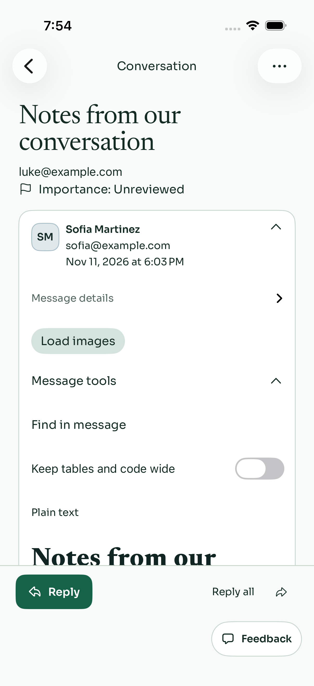
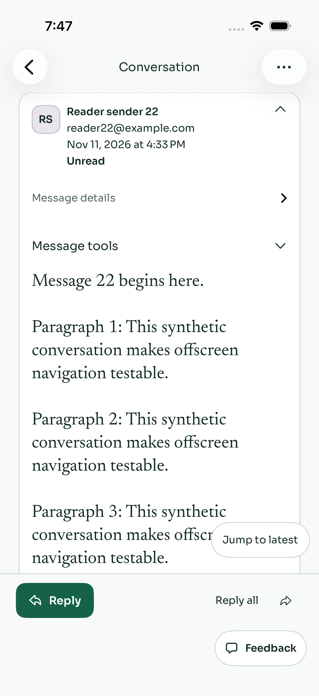

# Reader hit-target candidate after actual fb10 red

Root authorized exactly two narrow source items after [read-only artifact triage](triage-before-edit.md). The before-fix proof remains actual fb10 light186PASS/2FAIL/5image-scope skips, dark not run, exit65; [identity](identity.log), [all failure summary](Orca-summary.json), [ordered boundary excerpts](ordered-boundary-excerpts.log) and exact hashes are retained in [source scope](source-scope.json). No candidate execution or fixed-runtime claim follows.

## History: stronger reachable-stimulus precondition

Actual Show21 is AX-hittable at y56..100 behind navigation y62..116. Its same tap leaves Show present/Hide absent, earliest history absent and unread header at the same y132 after the original5s wait. This is no observed net expansion, not proof of stale post-expansion anchors or broken unread visibility.

The existing at-most6 `app.swipeDown()` loop now accepts Show21 only if it exists, is hittable, has width/height>=44 and its FULL target fits the actual reader/app frame intersection below navigation.maxY+8 and above Reply.minY−8. It captures that precondition Boolean and asserts it before the original single Show21 tap. If unreachable within the unchanged budget/type, it fails that precondition honestly. It may use a previously permitted reveal gesture where the old false-hittable predicate used none; this is explicitly a test precondition correction, not a product jump fix. No post-tap corrective gesture is added. The same original5s jump wait starts immediately after the tap; all downstream assertions/deadlines/gestures and after-fixed-wait diagnostics remain unchanged. No permanent jump, anchor or visibility formula change.

## Wide: readable label and native control separated

Actual outer labeled Switch is `(40,583,322,28)` while its child native switch is `(301,583,63,28)`. The original tap's first captured0 and later off-state persist; the actual hit point/binding transition is not exported. Current evidence favors a composite target/activation mismatch over the old offscreen or delayed-first-value assumptions, without proving a specific UIKit event route.

The product candidate uses a wrapping/dynamic subheadline label, hidden separately from AX, plus a fixed-size labelsHidden native switch with the SAME wideContent binding and explicit full accessibility label. The Toggle's own minimum64×44 frame/content shape and the row's minimum44 height request a usable target without a row onTapGesture, double-toggle path, private API or state remount. No line limit/font cap is introduced. **The actual exposed AX frame, unique labeled Switch, native hit region and activation are still unverified:** an outer SwiftUI minimum frame alone is not claimed as a measured native44pt hit area. Hosted evidence must establish the real result.

`ReaderUITests.swift` is byte-identical to fb10/b455. It keeps the same label-based query, same wide.tap, first IMMEDIATE expected1 and all subsequent off/on, Tools collapse/reopen, live query/Find/format/state checks. Existing diagnostics still capture current frames/values/descendants. No child/knob-coordinate test, second tap, force-click or semantic wait is added. Sanitization/consent, body rendering inputs, chronology, footer, importance, account/session/routing and fixture content are unchanged.

## Actual before PNGs and limits

These are unmodified exported PNGs.63/76 are the identical Tools-expanded/off pair consistent with the named diagnostics; pre/post order is not manifest verified.99/9 match history frame/time/content before/after but lack exporter attachment-name mapping; no formal unique ordinal attribution or measured click coordinate is invented. Raw xcresult remains absent. Full synthetic raw artifact is root-retained externally.

## Requested next gate and acceptance

Freeze this concrete source/evidence diff for root review first, then request ONLY one allocated<=5s36-file Swift grammar check. No223 rerun: Foundation Core/API/controller/harness remain f153; runner/Tools retain1748; only the stated ThreadView block/test37 changed. No heavy command, local Apple UI, push/retry/watch/dispatch/child or unpublished catalog/query-wire integration occurred during preparation.

Grammar cannot establish SwiftUI/XCTest typecheck, native switch interaction, chronology/jump behavior, actual standard/AX light/dark geometry, image/privacy regression or complete product acceptance. All require current hosted execution and inspected screenshots. Publication stays held for root's current compose/mailbox audit and fresh source review. Existing e061 and fb10 runtime failures remain historical before-fix receipts, not relabeled passes.

## Scoped source review and exact grammar closure

Independent [feee correctness/security source review](review-feee-approved.md) is **APPROVED WITH COMMENTS**, with no blocking finding. The review does not establish activation, unique AX exposure or measured44pt interaction area. Root implemented only the optional one-line [a71 guard](root-guard-a71.patch) after the retained full-containment assertion: if that precondition has failed, return instead of making a secondary occluded tap. The failure stays recorded; successful single-tap/immediate5s and every downstream assertion remain unchanged.

The allocated original feee gate passed36 Swift grammar parses in0.451s, clean equal start/end SHA and all36 source hashes, empty parse log; [exact receipt/resources](grammar-feee9ee7/manifest.json). Root's separately allocated exact `a71f0bdf405850dd2e4da1dc5a158a2eee1cc538` gate passed36 grammar in0.185s (wrapper0.403s), equal clean identity/all36 hashes and empty log; [exact receipt](grammar-a71f0bdf/manifest.json) and [resources](grammar-a71f0bdf/resources.json). Both manifests/hashes were independently checked against their exact Git objects before this docs-only retention. No gate was rerun for this checkpoint.

[Final source/tree identity map](final-source-scope-a71.json) binds unchanged Core/Compose/OrcaTests/API/shared to f153, Tools/runner to1748, the wide-control product block tofeee and unchanged wide test/diagnostics to b455. Only the root one-line history early return differs from reviewed feee source. Prior223 and four-runner proofs retain their original revisions. This retention is documentation only; it cannot promote grammar to XCTest/SwiftUI acceptance or relabel the before-fix fb10 runtime red.

Root owns current compose/mailbox audit, actual new standard/AX light/dark after-screenshots, natural hosted gates and all33/final merge acceptance. No CI poll/retry/watch, heavy/UI repeat, query/catalog wire integration or push occurred during this documentation phase. Publication remains held for explicit root clearance.
