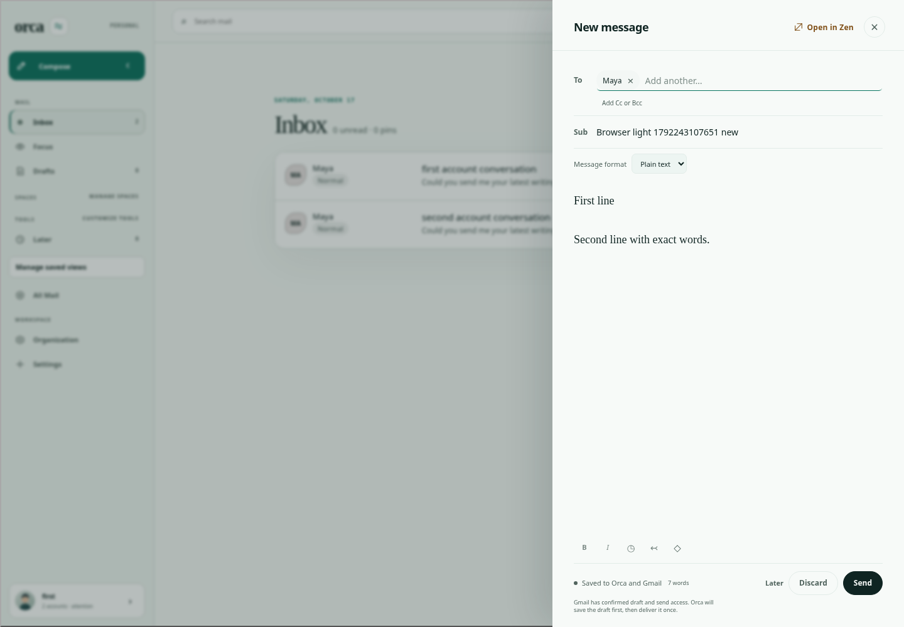
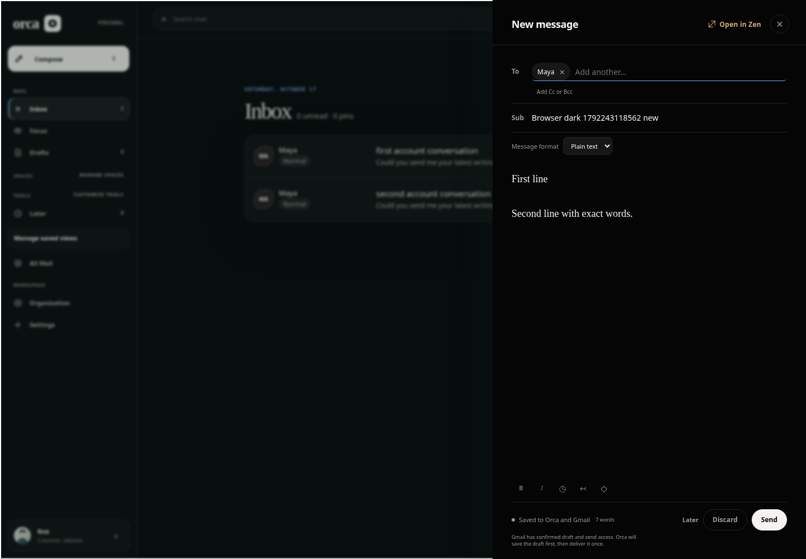

# Compose send scope: October 17 functional sweep

Base: `5baf7f3ea9e208001c607a7bc0f5c418fb056d58`. Tested and independently reviewed executable: `c3517e80c53bc750e76cc99141123dbaaa42dfe1`. Later evidence commits do not change executable code.

## Reproduction and cause

Begin sending a synthetic draft, hold its response, select another account or draft, and type new writing. On baseline, releasing the old send replaces the current writing with an empty draft for the old account; the component also invokes the obsolete `onSent` callback that can close the new composer. The App keeps the controller mounted across draft selection (`App.tsx` calls `useComposeDraft` with changing scope).

`sendDraft` captured old account/scope values while asynchronous continuations read and wrote shared refs belonging to the new scope. Its final reset was unconditional. Guarding only reset would leave stale create/update continuations and delivery-recovery requests active.

The fix captures a monotonically changing scope generation and checks it at asynchronous boundaries, before shared-ref writes and before further delivery requests. Changing account/draft or unmounting invalidates that generation, including A → B → A transitions. Old cleanup cannot unlock a newer send. A private cancellation error suppresses obsolete component completion and `onSent`; normal current-scope delivery remains unchanged.

## Validation

- Baseline `baseline-red.log`: six deterministic failures across account, draft and A → B → A transitions during create/send; ordinary delivery passes.
- Baseline `component-red.log`: isolated obsolete successful delivery calls `onSent` once when zero is expected. Failure-response control passes.
- `lifecycle-green.log`: 17 tests / 78 assertions pass, covering create/inspect/update/send waits, account/draft/return transitions, queued autosave, a newer pending controller send, obsolete component success/failure, and ordinary send.
- All workspace typechecks and production build pass.
- Full local tests: **1,517 pass, zero fail** (95 shared, 763 API, 659 web), including the new lifecycle suite.
- Expanded baseline sweep: 95 tests across 14 files passed; 16 recent Gmail date-recovery/persistence tests passed. Earlier 58 account-isolation checks were reused on unchanged main. See coverage matrix.

Independent agent `/root/sweep_review` reviewed exact executable against base and independently reran the new suite (17 pass, 78 assertions): no blocking issue found. It confirmed shared-ref corruption and direct App draft-scope reachability. Separate agent; no model-diversity claim.

Reproduce in a frozen dependency checkout:

```sh
bun test apps/web/src/compose-send-lifecycle.test.tsx
bun run typecheck
bun run test
bun run build
```

To reproduce baseline failures, run this test file against the base version of `compose-workspace.tsx`; the retained initial red matrix covers create/send transitions. A broader baseline attempt also exposed test cleanup interference after its expected concurrent-send rejection; that attempt is not used as the authoritative count. The isolated component rerun establishes its failure independently.

## Limits

Synthetic Happy DOM/SQLite/provider fixtures only; no live mail. An already-issued remote request may still complete after navigation. This patch does not cancel provider delivery; original-scope idempotency storage is retained for later reconciliation. The reused composer remains disabled until an obsolete request settles, matching existing behavior. Concurrent-new-send coverage exercises the controller, not simultaneous UI clicks. Attachment conversion and unmount are guarded but have no dedicated new regression cases. Same-scope close/reopen, visuals and native UX are not established by these unit tests.

PR235 performance/search changes, thread-loader cache lifecycle, PR252 reader Retry fixtures, PR253 native diagnostics and PR254 images are untouched. No runtime security/credential changes, production migration, merge, deployment or release. Existing automatic PR CI is used without manual native dispatch.

An initial local browser attempt failed before exercising any scenario because this fresh worktree lacked built frontend assets (`ENOENT apps/web/dist/index.html`). Its evidence is retained outside the checkout under `/workspace/scratch/bug-sweep-expanded-2026-10-17/browser`. The corrected attempt follows a successful production build and is recorded separately.

Corrected built-browser attempt: all **16 compose scenarios passed** (8 light, 8 dark), zero page errors, Chromium 154.0.8037.57 from the saved image. The broader wrapper then stopped at the reader harness's hosted-CI-only guard; no local reader/catch-up pass is claimed and no guard was bypassed. Existing automatic hosted CI must supply those results. `browser-results.json` records compose outcomes.




These reviewed synthetic screenshots show the unchanged compose layout during the existing persistence scenario. They are browser smoke evidence, not visual reproduction of the held-send regression (which is covered by deterministic component tests). No theme/layout change was made.
