# October 12 final PR review — web evidence

All screenshots on this page are **web Chromium on Linux**, using synthetic mail and isolated loopback API/SQLite. They are not native iOS screenshots. This evidence-only branch does not change any PR head and is not intended to merge.

Main: `ab541c00d6e8dc23812d05004c0611fe9fd19c32`. Proposed order: **238 → 240 → 241**. All three merge cleanly; PR239 sanitizer and mobile readability source remain intact.

| PR | Reviewed head | Verdict |
| --- | --- | --- |
| [238 — unread Focus](https://github.com/lukebrevoort/orca/pull/238) | `bf5587020af7cf70dba36dd8c52b84ee2041cd61` | Independent review found no blocking product defect; requires Luke's acceptance of routing/priority semantics. See preserved test caveat below. |
| [240 — discard/autosave](https://github.com/lukebrevoort/orca/pull/240) | `fb9b4a0365e851dd800855182b43908d1015d316` | Ready for human review; web visual inspection gap closed. |
| [241 — reader scroll](https://github.com/lukebrevoort/orca/pull/241) | `2825f65225470bb6400e7006d650461d4f573402` | Ready for human review; exact-head and combined browser checks pass. |

## PR238: Inbox before and after reading

The same Focus message stays categorized as Focus but loses promoted priority after it is read. The Focus lens contains the same eligible Inbox membership filtered to Focus/Notify, including read Focus. Legacy implicit Focus/Notify placement now inherits the next explicit destination or Inbox fallback; stored placements are preserved. Luke must approve those semantics before merging.

These images tested current main + PR238, local commit `405527baf151b9987d2fd98de28e745ea558d6a7`, tree `b25455e8ec0d2e628069a03fd7afc5c0ec40a7b5`. The same real-API scenarios passed on the final combined tree. All six shown images were inspected by the independent reviewer.

| Web state | Light | Dark |
| --- | --- | --- |
| Before reading — unread Focus promoted | 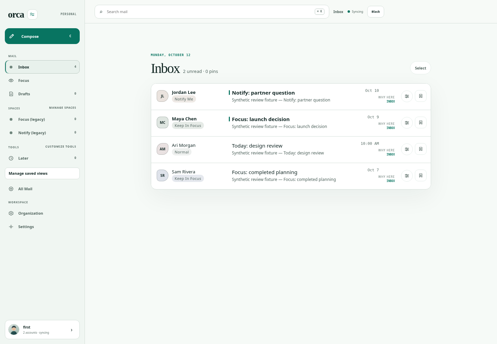 | 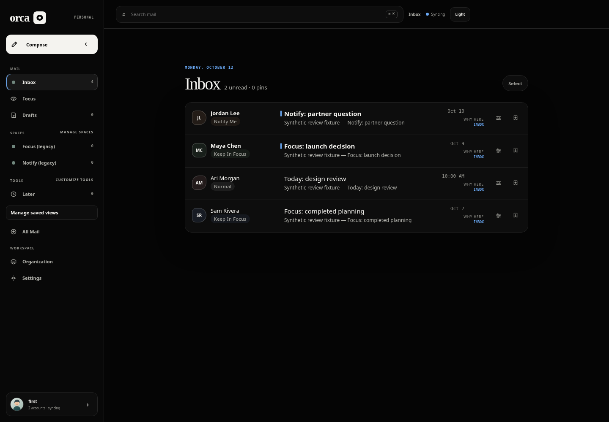 |
| After reading — Focus returns to date order |  | 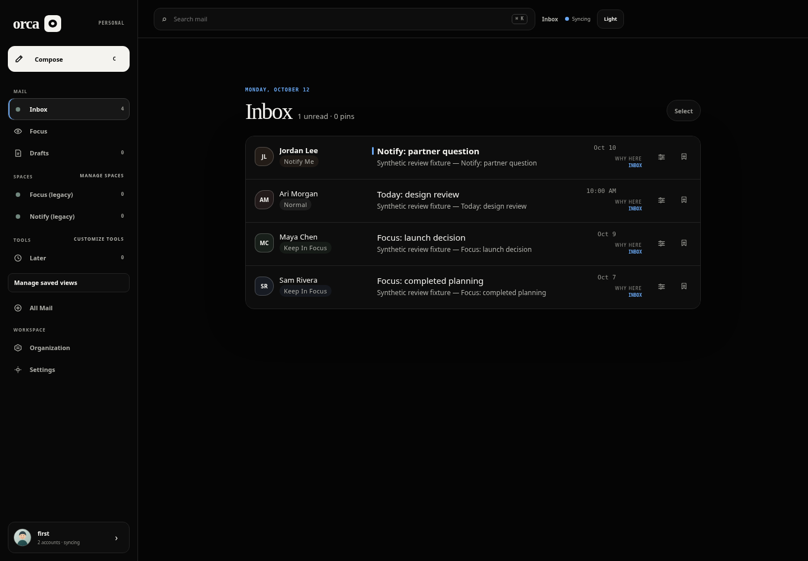 |
| Focus lens selected | 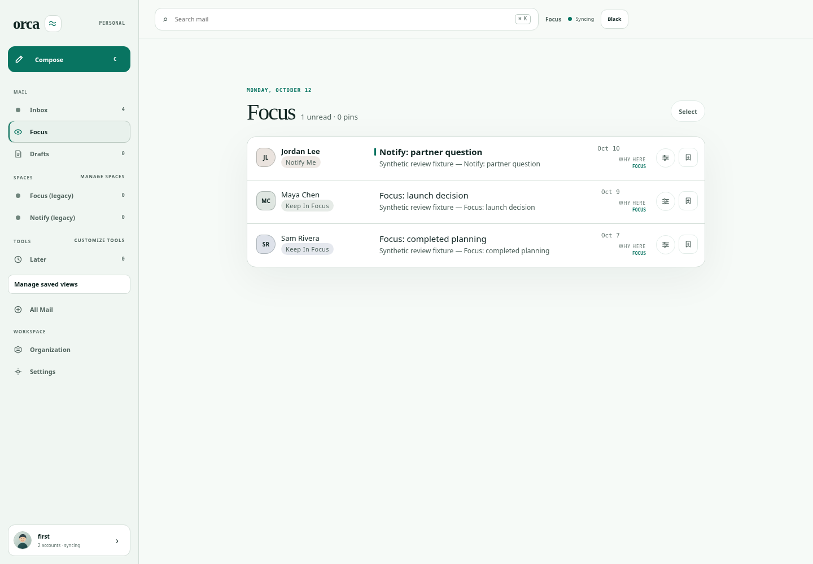 | 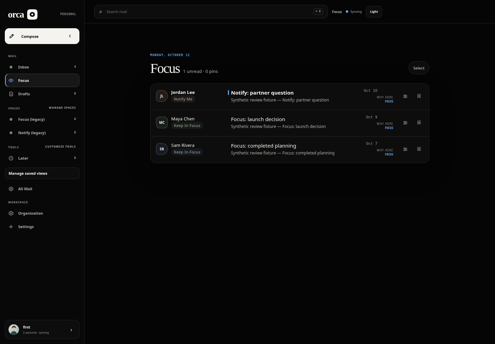 |

## PR240: discard during the first save

Exact PR240 production build, Chromium 154.0.8037.57. All 16 compose scenarios passed, including first-save discard, account changes, draft recovery, conflicts and uncertain delivery. The eight images below were inspected: content remains visible during discard, Discarding is labeled, and Send is disabled. Before the fix, clearing the editor before the first POST completed left a server draft; after the fix, the first save drains before the scoped DELETE, and failure preserves writing for retry. Existing red regression remains in the PR's verification record.

| Web state | Light | Dark |
| --- | --- | --- |
| Ready, first save pending |  | 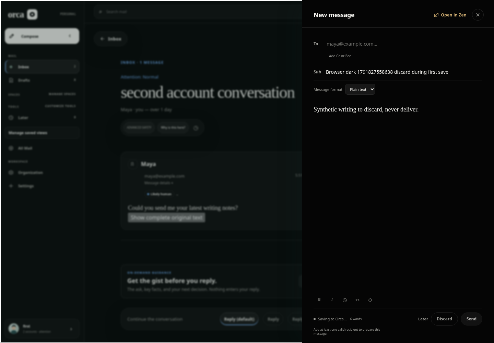 |
| Hover |  |  |
| Programmatic focus | 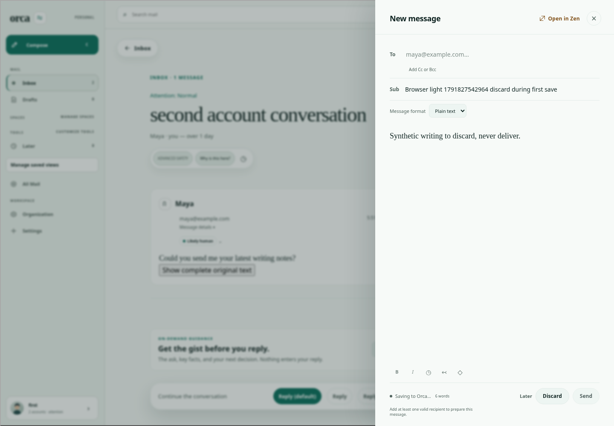 |  |
| Discard pending |  | 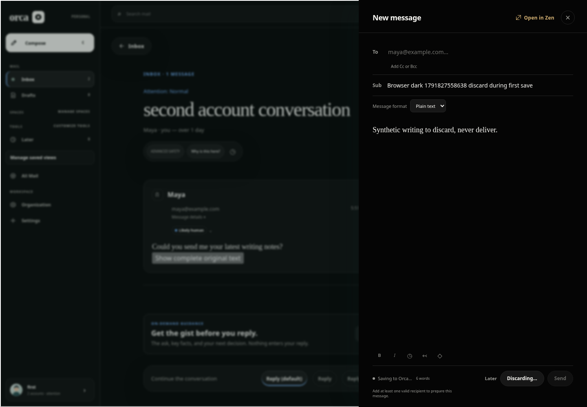 |

## PR241: reader scrolling after integration

Final combined tree: six light/dark mobile → desktop → mobile scenarios passed, including actual offsets and keyboard activation/focus restoration. Four representative images below were inspected; 18 were generated. Exact PR241's previously inspected 18-image run and before/failure evidence remain in its [committed gallery](https://github.com/lukebrevoort/orca/blob/2825f65225470bb6400e7006d650461d4f573402/docs/verification/reader-jump-top/README.md).

| Web light mobile keyboard focus | Web dark mobile keyboard focus |
| --- | --- |
| 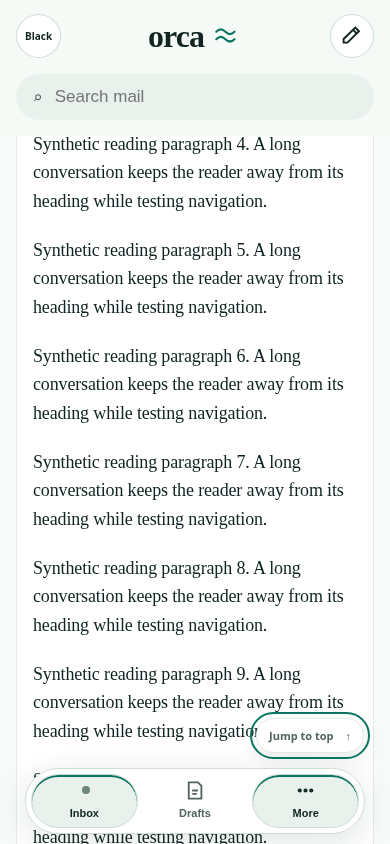 |  |

| Web desktop after resizing | Web mobile after resizing back |
| --- | --- |
| 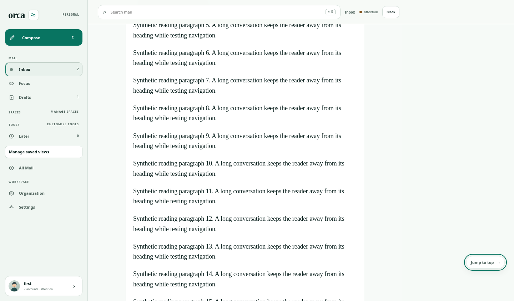 | 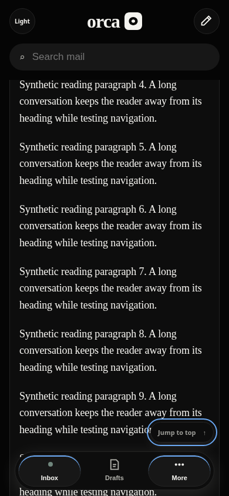 |

## Integration and coverage boundaries

| Stage | Local commit | Tree |
| --- | --- | --- |
| Main +238 | `405527baf151b9987d2fd98de28e745ea558d6a7` | `b25455e8ec0d2e628069a03fd7afc5c0ec40a7b5` |
| +240 | `a9375f27eaa25b8a028455512345e189c1cae6cc` | `5ea2dbe11d6cc6267e73edb15b484b2cca5ab56a` |
| +241 | `5182b18631942419df42ab5871d9a546228880bb` | `d58bb3db5e88c45b4edbdbbdc64f6332527c53a0` |

Final combined local checks: **1,459 tests passed** (740 API, 624 web, 95 shared), workspace typecheck, production build and API smoke. Independent combined review passed another 74 tests / 529 assertions with no blocking integration finding. Combined browser: 16 compose scenarios, 6 reader scroll scenarios, and both-theme Focus ordering/read transitions passed. No source fix was needed.

Preserved test caveat: the current-main+238 focused run passed 213 tests and failed one existing Retry request-count assertion (expected 2, received 3). The unmodified isolated test then passed, and the complete interaction file passed 127 tests / 809 assertions. Scratch instrumentation reproduced the same assertion failure on **unmodified main**: the existing 100 ms prefetch timer adds requests, and the assertion uses a substring matching both the selected thread and its `-next` sibling. This is a demonstrated pre-existing timing-sensitive test assertion, not a new PR238 runtime defect. See [original failure](preserved-focused-failure.log), [baseline prefetch trace](baseline-prefetch-trace.log), and [unmodified interaction rerun](interaction-rerun.log). The failure was not hidden or patched in these PRs.

Focus screenshot harness setup failures are also preserved in the workspace: an unquoted SQL column and an unsupported fixture override produced incomplete seed data; the fixture was corrected to supported sender Focus/Notify rules. Product source was unchanged. Focus screenshots verify persisted order after an Inbox URL reload, not browser Back scroll restoration. They cover representative desktop states, not a comprehensive accessibility audit.

Hosted checks on all three existing PR heads are terminal success. PR238 native reader workflow checked out exact `bf5587020af7cf70dba36dd8c52b84ee2041cd61`; its fixture browser/compose-native jobs used merge `5542febbd7ba39c0ddf79444d89b1502aa13dad5` against older base `29958f22a1f91dd90c46766a67238603a5a5f857`. Those receipts do **not** establish hosted validation of the new combined tree. Native screenshots remain uninspected.

Fresh combined native workflow access was unavailable: GitHub CLI GET `actions/workflows/native-reader.yml` returned `Forbidden`; no callable workflow-dispatch connector was exposed. No dispatch, rerun, access workaround or artifact download retry was made. Library upload had previously failed (`hosted apps tools/list request failed: network`); no Library file IDs are claimed. This committed gallery is the delivery fallback.

Luke's remaining choices: accept PR238's semantics; review the web gallery; decide whether to require a fresh hosted combined native run and native screenshot inspection before merge. All three PRs remain drafts. No merge, deployment, production migration, live mail, paid infrastructure, credential change or PR235 edit was performed.

Machine-readable receipts: [checks and source identities](receipts.json), [exact PR240 browser](compose.json), [combined compose browser](combined-compose.json).
