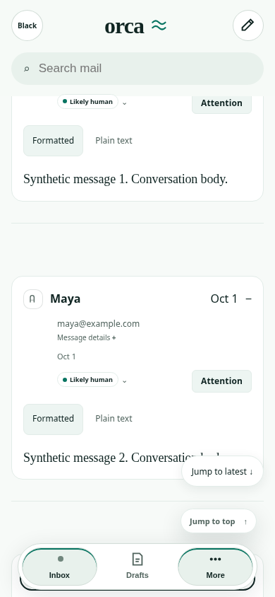
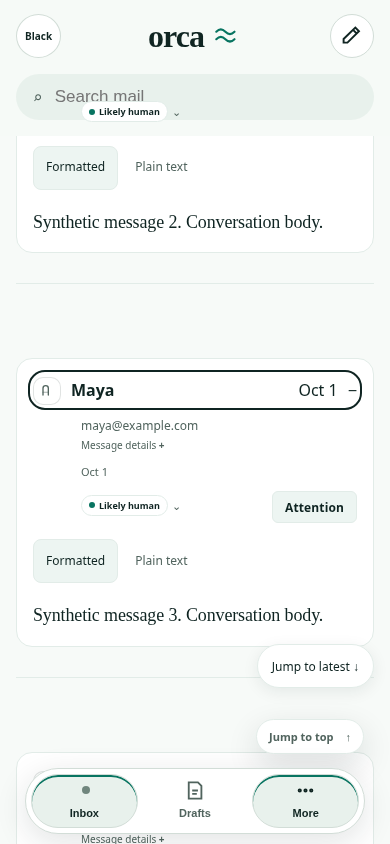
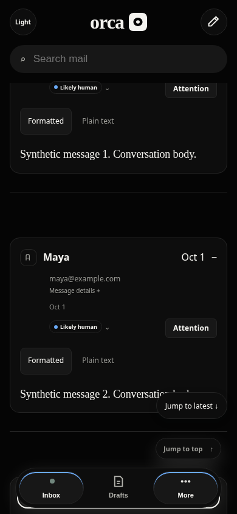
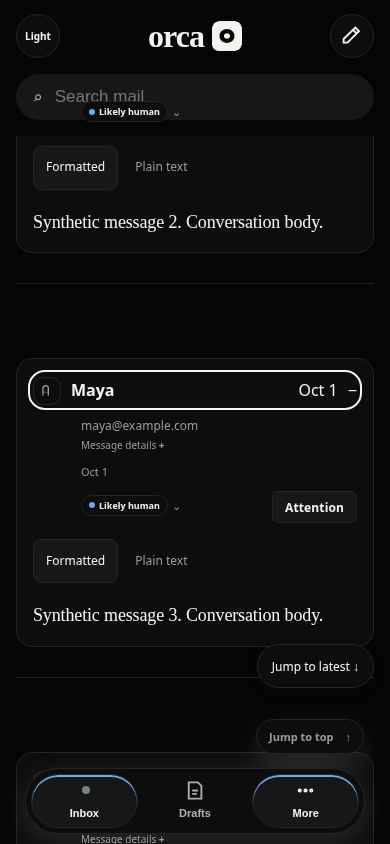

# Mobile web reader keyboard clearance

Baseline: `0e6805131a9c8386107bf70f598e2b61b0cf6a0b`.

Synthetic 60-message conversation; expand all, focus first message toggle, then 42 Tab and 42 Shift+Tab presses. Chromium 154, 390×844 viewport, reduced motion, light/dark, external browser requests blocked. No production mail, sending, native checks or CI dispatch.

Before: 20 focused-control centers per theme are covered by sticky/fixed chrome (plus one expected failing mobile scroll-padding assertion per theme). The illustrated third message toggle receives keyboard focus at y800–830, entirely behind navigation at y768–834. `elementFromPoint` hits the navigation, not the control. This is a viewport screenshot, not full-page stitching.

After: all 168 focus center hit-tests pass; the same toggle is at y375–405. Scroll-padding is active-reader-only and phone-only and clears the existing sticky header and floating reader jump controls as well as navigation. No visual layout or navigation ordering changes. Desktop root scroll-padding remains `auto` after resizing; mobile clearance returns after resizing back.

| Theme | Before | After |
|---|---|---|
| Light |  |  |
| Dark |  |  |

Raw geometry and center hit-test evidence: [before](before.json), [after](after.json).

Validation: production TypeScript/Vite build; new keyboard regression; existing six reader scroll/jump/resize scenarios. Regression is integrated into the existing hosted reader fixture suite. Local execution used a fresh cloud Chromium with the same exported helper and disposable loopback fixture; it did not masquerade as hosted CI.

Limits: mobile web only. Not iOS simulator, Safari/WebKit, VoiceOver, touch/virtual keyboard, enlarged system fonts, or nonzero safe-area pixel verification. Safe-area insets are included in CSS but this browser fixture has zero insets. Keyboard focus center checks do not establish full-content visibility or app-wide accessibility conformance.

## Route scope regression

Combined verification caught the original selector matching the hidden, mounted reader outside its route. The extended test reproduced eight failures on head `34b9a90748e432b2b0fba0f2ed1621a275fbc35f`: Drafts before opening a reader, Compose open, Compose closed, and Inbox after closing the reader each retained `212px` root scroll padding in both themes. [Failing evidence](scope-before.json).

The selector now requires `.desktop-shell-reader`, the actual selected-thread state. The expanded [passing evidence](after.json) checks `auto` padding on all four non-reader states and `212px` in the open reader, plus desktop/mobile resizing and all 168 original focus checks. Drafts → Compose is exercised with Shift+Tab from Search, Enter activation, dialog-contained Tab focus, and keyboard close restoring focus to Compose. The unchanged canonical six scroll/jump/resize scenarios pass. Fresh reader screenshots were inspected; reader presentation is unchanged by the scope correction.
