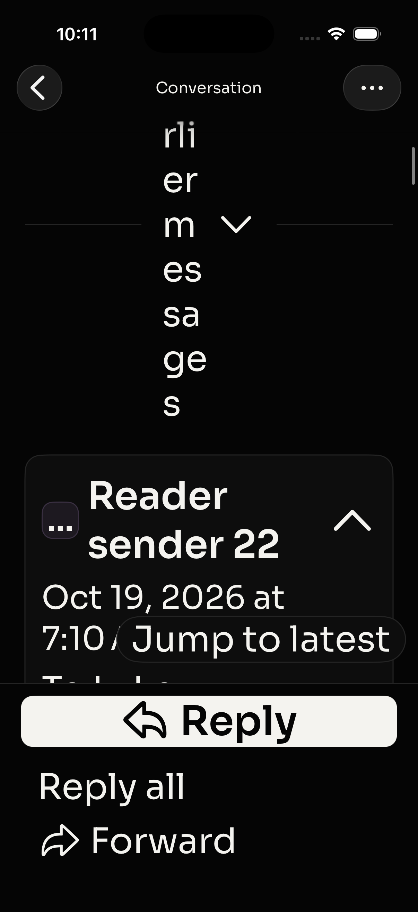
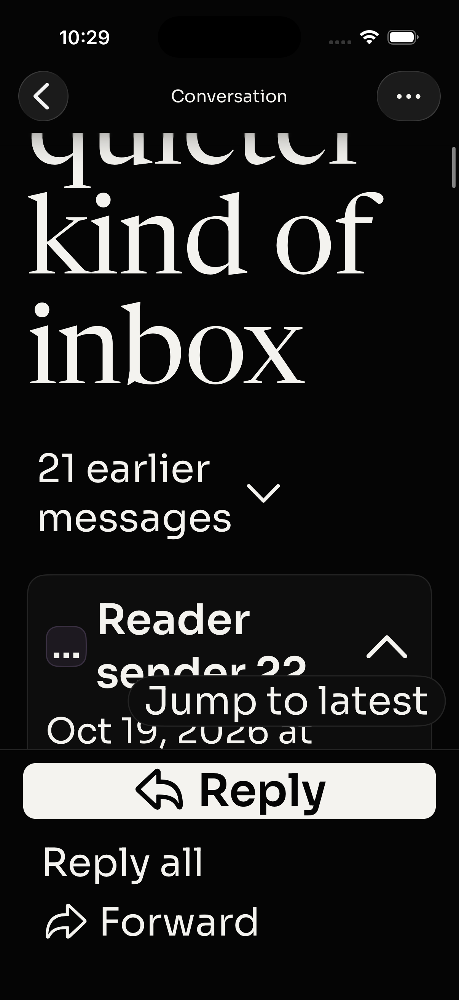
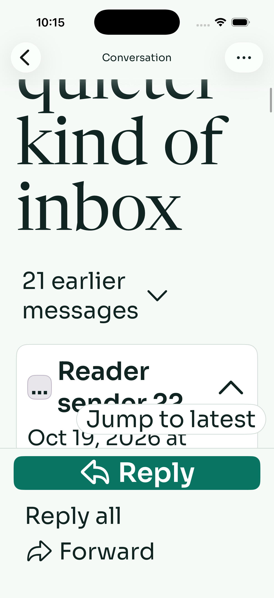

# Native reader layout fix and UI sweep

October 19, 2026, Homebase M1 MacBook Air / 8GB, Xcode 26.4.1, iPhone 17 simulator / iOS 26.4.1,402×874 logical points. Single build job and simulator lane, synthetic loopback mail only.

## Fix

At Accessibility XXXL, the earlier-message text was 44pt wide and 385.67pt tall, breaking whole words into one- and two-letter fragments. Flexible decorative separators competed with the button. The button now gets layout priority, separators are omitted at accessibility sizes, and the text may grow vertically. The label reads “21 earlier” / “messages” in two lines. Action, accessibility name/value,44pt minimum height and theme colors are unchanged. No CPU/latency performance claim.

| Before, current main | After, dark | After, light |
| --- | --- | --- |
|  |  |  |

The before image is scrolled so its top is partly above the viewport; the remaining letter fragments and full AX bounds establish the defect. The light image is from candidate a9ba8ed; product source is identical to final. Final dark image is from final executable below.

## Exact revisions and verification

- Base/current main: `0a9ecd6f9db027ce0cf6ede004311b2567e197fe`. Main/open PR ownership checked before implementation and before publication. PR 253 diagnostics, 252 web fixtures, 235 search excluded.
- Final executable and independently reviewed head: `e83278dc7af26114fce3260808187948cacc999c`. Later changes in this branch only add evidence/documentation.
- Unsigned single-job build-for-testing passed. All 45 installed bundle files exactly match built hashes: [provenance](final-provenance.json), [installed comparison](installed-verification.json). Original baseline 44 tracked iOS sources: [baseline provenance](baseline-provenance.json).
- Final regression negative control: final test source with ThreadView restored to base, original product behavior. It failed width 44 >63.6. [Failure summary](final-negative-summary.txt). The committed fix was restored and rebuilt before final passes. This hybrid is deliberately a negative control, not a claimed clean commit.
- Final head light: **1 selected test passed**, ReaderUITests/testEarlierMessagesRemainReadableAtAccessibilitySize. [Log](final-light-summary.txt).
- Final head dark: **3 selected tests passed**, the new regression, existing long-thread navigation, and image consent/loading/reopening/late-response rejection. [Log](final-dark-summary.txt).
- Before test relocation, executable `e297b6e5b4e31d520d43dc9a1a8fa07612bc2e1b`: **6 selected light tests passed**: earlier-message regression, draft conflict-copy recovery after termination, cancelled/reopened move catalog, HTML at accessibility size, long HTML scrolling/repeated opens, image interruption. Product code is identical to final; test relocation was separately rebuilt and verified. [Log](sweep-light-summary.txt).
- Initial test used an overly strict half-screen text-width threshold. Pixel inspection showed clean two-line words at 172pt. The final assertion compares text width to button width and height to width; both fail original 44×385pt text. Exact final negative-control run confirms this, rather than inferring a pass by relaxing the check.
- Independent reviewer `/root/native_layout_review`: no blockers on exact final executable; source/pixel review, no separate runtime execution. [Review](independent-review.md).
- New test is in ReaderUITests, selected automatically by existing reading scope in both themes. No workflow/runner modifications or manual CI dispatch. Hosted results belong to the draft PR's final-head check record.

## Additional sweep findings

**Known P2 remains: initial Jump to latest can hide the button before latest body is visible.** Reproduced again on current-main product source in light mode. Open 24-message fixture, tap Show 21 earlier messages, swipe(210,670)→(210,280) over0.5s, tap Jump to latest and let settle. Header 24 appears near bottom, body remains below reader viewport, jump disappears. [Settled baseline screenshot](baseline-first-jump-settled.png). Existing test 37 checks hittable sender heading, so its pass does not establish correct body alignment. Not fixed by this patch.

**New P2: Inbox view-picker label clips at Accessibility XXXL.** Launch with largest content size, inspect Inbox. “Inbox” becomes fragments, with part behind Search and part clipped in the menu capsule. Reproduced after separate launches in both themes. [Dark](baseline-a11y-inbox.png), [light](candidate-earlier.png). AX still has its correct menu name. Separate InboxView layout issue; no speculative patch here.

**Account switching:** manually switched original synthetic account → second@example.com → original. Second inbox contained only its unique “Second account only” marker; original rows returned. [Second mailbox](second-account-inbox.png), [returned rows](first-account-restored.png), [settled final inbox](final-restored-inbox.png). The initial return screenshot captures incomplete chrome during a transition; the later image confirms settled appearance.

**Compose/recovery:** the existing native conflict-copy test verified latest writing plus retained/removed attachment state after termination, preserved remote original, and delivered the synthetic copy once. [Final fixture counters](final-fixture-state.json): one send request and one mocked delivery, expected from that test. No live mail provider exists in this fixture. The reader and manual paths sent nothing.

## Reproduction and limits

Run repository `apps/api/scripts/mobile-fixture.ts --images` with Bun 1.3.14 and `--no-env-file` in a fresh private TMPDIR. Build-for-testing with CODE_SIGNING_ALLOWED=NO, ONLY_ACTIVE_ARCH=YES, -jobs1. Inject the fixture URL/token privately into a copied xctestrun as the existing runner does. Use test-without-building, -parallel-testing-enabled NO, and -only-testing:OrcaUITests/ReaderUITests/testEarlierMessagesRemainReadableAtAccessibilitySize. Set simulator appearance light/dark with simctl. The test enables the 24-message authenticated fixture and restores it in teardown.

This is bounded native verification, not a full-suite or production end-to-end pass. No physical device, iPad, rotation, VoiceOver speech, live OAuth,APNs or exhaustive localization coverage. Standard large and Accessibility XXXL tested; all intermediate sizes not exhaustively sampled. A new regression proves geometry and toggle semantics, not every earlier card's content. UI screenshots from automated tests can be partly occluded; the manually settled label images above are the visual proof. No web/API optimization, CI repair, release, TestFlight, account/security changes or Canvas-tab changes. No Library upload workaround attempted.

Cleanup: owned loopback fixture stopped; injected test configuration removed. Simulator left on settled synthetic first-account inbox, ordinary text, dark mode. Original private demo data and browser tabs preserved.
