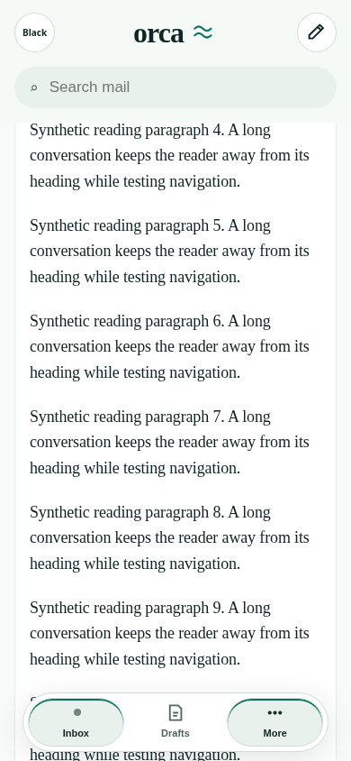
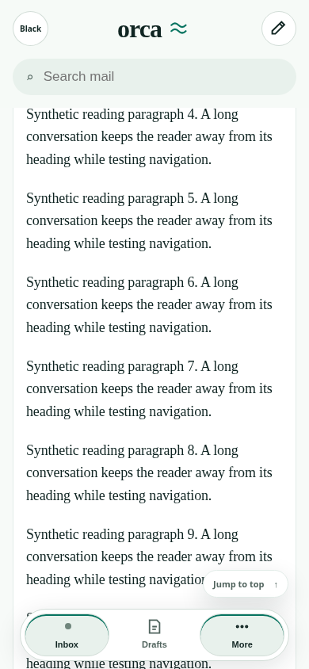
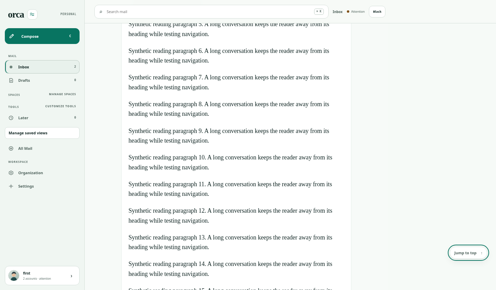
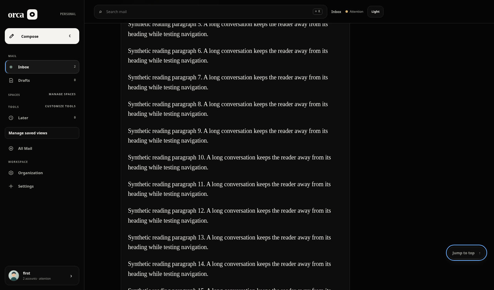

# Reader Jump to top: October 12 sweep

On mobile, the document scrolls while `.desktop-workspace` uses `overflow-y: visible`. The reader watched and scrolled only the desktop element. As a result, Jump to top stayed hidden after document scrolling; an already-visible button after resizing could focus the heading without returning the document to the top.

The fix checks the current container when calculating visibility and when activating the jump. Captured scroll events cover document and element scrolling; resize recalculates visibility across the breakpoint. Heading focus, reduced motion, desktop behavior, and listener cleanup are retained. No mail/read state, ordering, autosave, search, native source, style, or remote-image behavior changes.

## Exact identities and overlap

- Main baseline: `ab541c00d6e8dc23812d05004c0611fe9fd19c32`.
- Reviewed runtime and browser harness: `53511b270e62dd8b628a7f313d5b818a3616b502`.
- Frozen PR 238: `bf5587020af7cf70dba36dd8c52b84ee2041cd61`.
- Local synthetic integration: `a35cd5981fb331ea1854c1f96341604ee18ba4b7`; tree `dc25501110270a8d38f0a6fdef2d50d5b80a0e96`. This temporary detached commit combines the two candidates for verification only. No remote branch was merged or altered.

The initial sweep deferred because both PRs touched App.tsx. Exact diff review established that this was same-file overlap only: the fix changes MessageReader's visibility effect and jump handler at baseline lines 5739–5747 and 5788–5797, plus reader tests around line 3611. PR 238 changes Inbox/Focus membership, ordering, and read response handling elsewhere; its interaction-test changes are around lines 1721 and 4311. The complete synthetic merge is conflict-free, and its tests pass. PR 240, 235, 227, 224, 190, and 55 were also checked for scope; no work was taken from them.

## Reproduction and results

- Main RED: [two failing new cases, desktop control passes](main-red.log), before runtime edits. Mobile scroll keeps the button hidden; desktop-to-mobile activation leaves document offset 600 rather than 0.
- PR 238 RED: [the same failures](pr238-red.log) on its exact frozen source, using its own interaction harness with the two tests added.
- Real Chromium RED: [unchanged main times out waiting for the hidden jump](baseline-browser.json) after scrolling the actual mobile document. This is a runtime failure, not simulated geometry.
- Main GREEN: all 1,428 workspace tests passed (730 API, 603 web, 95 shared). Typecheck, lint, production build, and isolated API smoke passed. Targeted navigation: 42 passed / 302 assertions.
- PR 238 plus isolated patch: 50 passed / 339 assertions, including its Focus contract. Full synthetic integration above: the same 50 tests pass; all workspace typechecks pass.
- Linux cloud Chromium 154.0.8037.57 GREEN: [six scenarios](cloud-browser.json), light/dark × mobile → desktop → mobile, using one mounted reader per theme, actual scrolling, Formatted/Plain text interruption, keyboard activation, zero unexpected writes and zero page errors. Eighteen screenshots cover default, hover, and focus states. The existing control has no selected or disabled state.
- Independent review of `53511b270e62dd8b628a7f313d5b818a3616b502`: no blocking findings. Reviewer independently ran 31 reader/navigation/restoration tests, 197 assertions, and reviewed listener cleanup, focus, reduced motion, PR 238 hunks, and the synthetic fixture boundary. Reviewer did not independently rerun Chromium or inspect pixels; the implementing agent inspected all 18 candidate screenshots.

Reproduce the unit regressions with `bun test apps/web/src/App.interaction.test.tsx -t 'reader jump|jump-to-top'`. The new `apps/web/scripts/reader-scroll-regression.mjs` is invoked by the existing hosted reader fixture, so one ordinary PR workflow run exercises the browser regression and exports screenshots. No duplicate dispatch is required.

## Preserved harness failures

The first cloud-browser attempt [failed its focus assertion](harness-keyboard-failure.json): Tab away from the floating button scrolled to a header control, correctly hiding Jump to top before Shift+Tab. Keyboard modality is now established before the test scroll, and the actual focus-visible and Enter assertions remain required. A second attempt [measured zero scroll immediately after resizing](harness-resize-failure.json); it now waits for two animation frames before measuring the new layout. The final test still requires at least 850 px of real scrolling, visible control, offset zero after activation, and heading focus. These were harness corrections; runtime was not changed to mask them. The fixture's existing automatic synthetic Gmail-sync request is explicitly permitted, as in the older harness; actual provider transport is stubbed.

## Screenshots and limits

These are actual production-app captures with synthetic mail, on a fresh Linux cloud Chromium profile. External browser requests were blocked, so fallback fonts are used. They are not native iOS, Safari, physical-device, VoiceOver, or Dynamic Type validation. No live mail, credentials, production migration, paid infrastructure, or deployment was used. Hosted checks and artifact links are recorded in the PR; pending checks are not counted as passes. Prior artifact-download HTTP 403 restrictions were not retried or bypassed.

| Baseline: hidden after scroll | Fixed: mobile light |
| --- | --- |
|  |  |

| Mobile dark keyboard focus | Desktop light keyboard focus |
| --- | --- |
|  |  |

