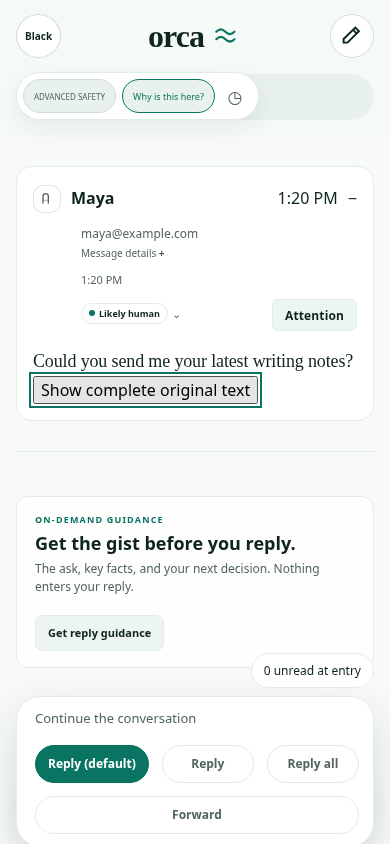
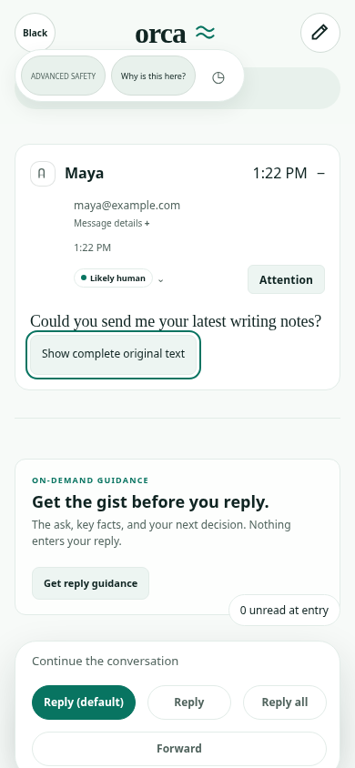
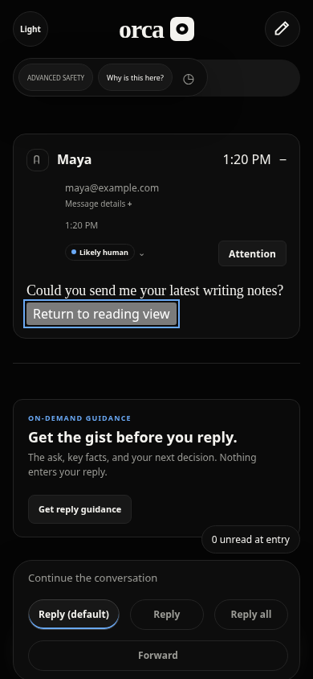
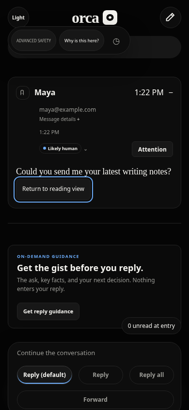
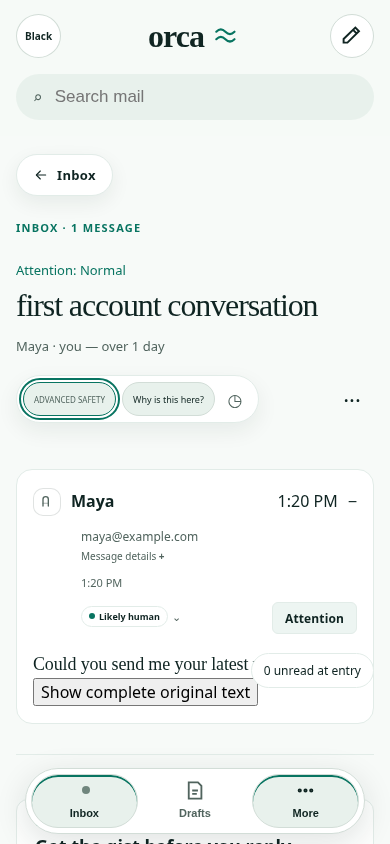
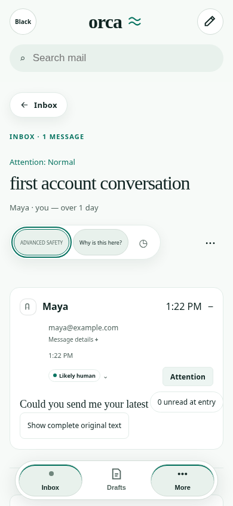
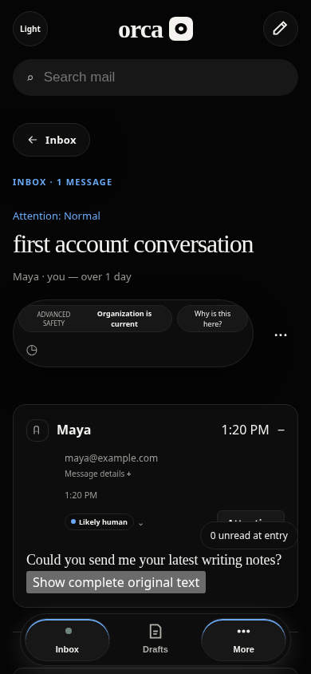
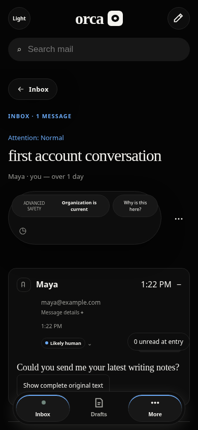

# Reader touch targets — responsive web

Main `5baf7f3ea9e208001c607a7bc0f5c418fb056d58` renders Advanced safety and Why is this here? at34px high, Remind me at34×34px, and Show complete original text at28px high on phone widths. This patch makes these four controls at least44 CSS px at widths up to760px and gives the original-text toggle a theme-aware button treatment. It is a usability improvement, not a claimed WCAG violation or native iOS fix.

Executable: `2ecf31dc99f7751e4cbc1a29a431a00e62b229a4`. Only a class attribute and scoped CSS affect product behavior; no mail/cache/search/compose logic changed. Evidence-only commits are identified in the PR.

## Before and after

Synthetic production browser,390×844. Screens show the real app and synthetic mail; no design mockups. All default, hover, focus, original-text selected, safety/evidence expanded and placement-pending disabled captures are in the adjacent folders.

| State | Main before | Candidate after |
| --- | --- | --- |
| Original text, light focus |  |  |
| Original text, dark selected |  |  |
| Safety, light focus |  |  |
| Placement, dark disabled |  |  |

## Verification

- Same regression on unchanged main:10 contexts;74 measurements below44px (three mobile widths × two themes × four controls × default/hover/focus, plus two pending-placement states). Expected assertion failure retained in [before/failing-check.log](before/failing-check.log), [measurements](before/results.json).
- Committed executable:10 contexts, zero failing target measurements. At320/390/760 all four controls are44px high and reminder44px wide. At761/1440 the dimensions match main. CSS changes are phone-only; hover-color snapshot equality is not claimed. [After measurements](after/results.json).
- Check also verifies left/right target hitability, labels, keyboard-focus indication, original-text toggle with Enter, opening/closing safety and evidence dialogs, real in-flight placement request/disabled state, no horizontal page overflow, no page errors, and no unexpected writes.
- Reader body unit tests:12 passed/54 assertions. All workspace typechecks and production web build passed. [Unit](unit.log), [typecheck](typecheck.log), [build](build.log).
- Chromium154.0.8037.57 on Linux, Node24.19.0, Bun1.3.14. Image-provided Chromium differs from CI's locked Playwright browser; hosted results are recorded separately. New contexts, synthetic authenticated loopback API, blocked external requests. A read mark and synthetic provider-refresh are allowed; no drafts, sends, reminders or organization mutations are exercised.
- Full catch-up regression and hosted checks are recorded in the PR/task record when terminal. No fix claim for the previously intermittent44px return-anchor shift.
- Two initial harness-development failures (reminder accessible-name lookup; role query of modal-hidden background) occurred before the final comparison. The retained final before/after runs use the same corrected harness. These were test-selector issues, not product regressions.

## Reproduce

Use a clean checkout and installed frozen dependencies. Build with `bun run --cwd apps/web build`; start `bun --no-env-file apps/api/scripts/compose-fixture.ts`. The fixture prints a private temporary connection-file path. Pass it to:

```sh
ORCA_CHROMIUM_EXECUTABLE=/usr/bin/chromium node apps/web/scripts/reader-touch-target-regression.mjs <connection.json> <new-evidence-directory>
```

Omit the Chromium override where Playwright's pinned browser is installed. Stop only the fixture process you started. Do not publish its connection file. The existing hosted reader harness invokes this check automatically; sanitized screenshots and aggregate results go into its existing artifact. No workflow dispatch is needed.

## Investigation handoff and native limitations

| Surface | Evidence | Remaining gap |
| --- | --- | --- |
| Web reader touch controls | Red/green matrix above; independent review recorded in PR | This patch is limited to four controls, not a complete target-size audit |
| Web reader anchors/long threads | Original main investigation12 scenarios + one follow-up preserved anchors | Intermittent44px shift not reproduced; not fixed by this patch |
| Web inbox/reader/compose | Main investigation12 light/dark1440/390 states, no reported axe WCAG2A/AA/2.1AA violations or horizontal page overflow | Limited synthetic states, not accessibility clearance or search/persistence verification |
| Native compose/recovery | Candidate#254 scoped CI success; original main job still contains one unidentified failure | Original assertion missing; #253 diagnostics does not fix its cause |
| Native reader/navigation | Existing reading scope tests long-HTML scroll/end, repeated open/back, Accessibility XXXL reply actions | Current artifact pixels unavailable; VoiceOver and live text-size changes unverified |
| Native account/search/pagination | Existing search-and-clear UI method; account/cursor model tests inspected | Account-switch interaction, multiple-page error/retry UI, in-flight query switching need simulator tests |
| Native images | #254 candidate, still unmerged: actual prior-owner simulator blocked/loaded/loading captures | Main has no Load images action; partial/error screenshots and actual image-button hit regions need testing |

Native image captures belong to executable `edcc10f0d9ff3d5566c26ed4daacc5bd75fa8d2a`, not this patch or main: [light/dark gallery](https://github.com/lukebrevoort/orca/tree/6d5a862610d15d5488616963820d0b19ad779d0e/docs/pstack/evidence/ios-images). They were visually inspected, are synthetic iPhone17/iOS26.4.1 simulator captures, and are not newly downloaded hosted-CI screenshots. Loading captures include transition artifacts; settled fidelity is not established by those captures.

Native pagination handoff to functional owner: `apps/ios/Orca/Mail/InboxView.swift:131` renders only error text when rows remain. `apps/ios/OrcaTests/OrcaTests.swift:2436` preserves the cursor after400/401/503 but never exercises a user retry. Exact next synthetic simulator scenario: load page one, hold then fail page two with503, verify existing rows/query remain, restore service, test pull-to-refresh and last-row reappearance, then verify successful recovery with no missing/duplicate rows. An explicit retry affordance should be evaluated from that interaction. Recovery is not claimed impossible; no simulator reproduction was performed here. Native source files remain owned by the functional lane.

Ordinary connected GitHub artifact tools successfully return artifact metadata and downloadable file references for run38980170051 (#254) and original failing artifact12054980076. Fetching the authorized download URL from this environment returns proxy403. The ordinary file-materialization tool also returns a signed download-host URL, not local bytes. No tokens/configuration were changed, no alternate unauthorized route attempted, no Homebase access, and no blind hosted run dispatched. Existing scoped native runs cannot establish missing account/pagination/VoiceOver coverage.
