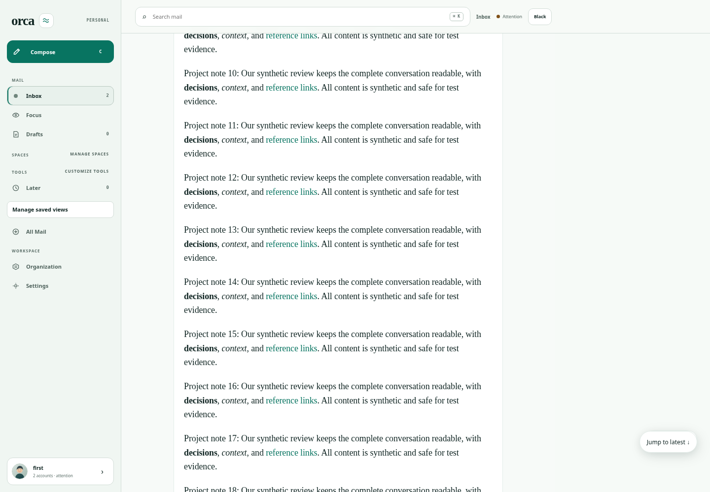
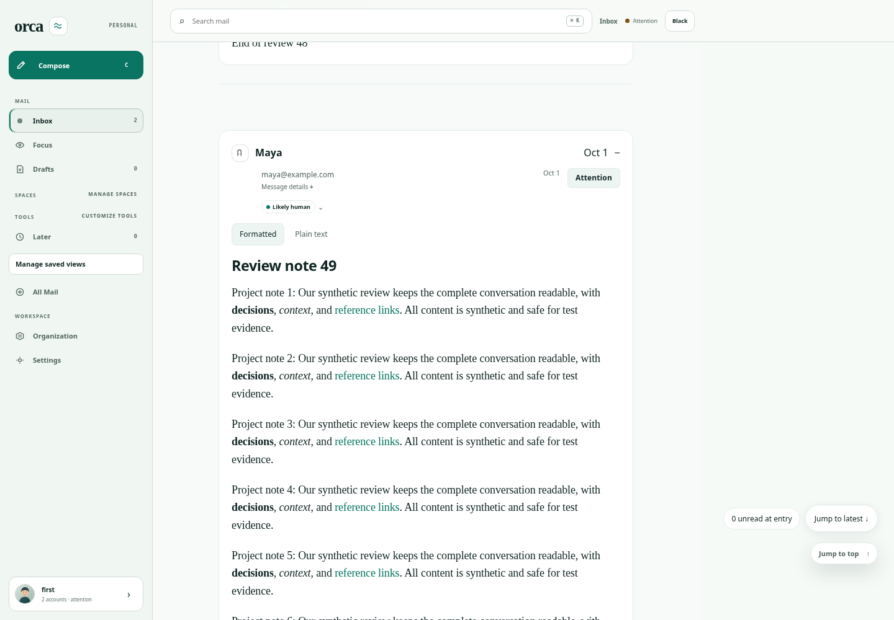
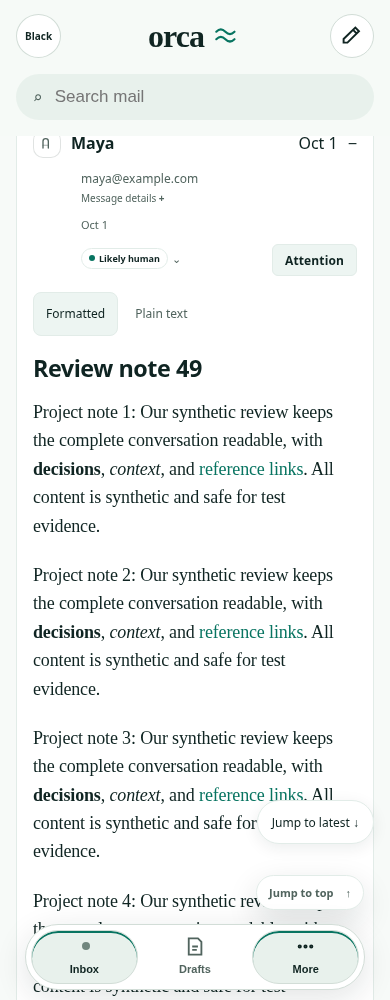
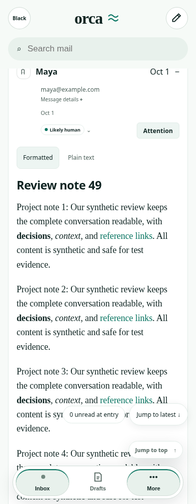

# Deferred-focus follow-up

Baseline: `9844aca646feabbc843980ecdba1bf5e5fe34b14`. Pre-fix PR runtime: `65b85b84e32eb64db9ac1de57a3c7a37177099f0` (head `b04d493f87b1bcfda58c290b44d794553d7cd91b`). Fixed runtime: `4dccb4aa842521f5a4366f81a87c3e5936f004df`.

The stronger fresh-document test exposed an existing defect, reproduced identically on baseline and the pre-fix PR: Chromium scrolls a focused link into view before React's focusin handler expands deferred body geometry. That expansion then moves the link outside the viewport. Merely reading layout after the expansion did not repair it.

The fix retains the browser's visible target offset synchronously through that one geometry transition, adjusting the desktop scrollport or mobile document as appropriate. Offscreen focus with `preventScroll: true` does not trigger a reveal. Restored/exact geometry and display controls bypass this correction. Deferred rendering remains enabled on fresh entry; no global disable, API change or storage was added. Existing hosted focus/Find assertions remain intact, with an added independent fresh-document preventScroll check.

## Reproduction and raw evidence

[Probe source](focus/probe.mjs), synthetic 60-message HTML fixture, Chromium 154.0.8037.57, CPU slowdown 4, desktop 1440×1000 and mobile 390×1000. Use the same private loopback fixture as the main README; `node docs/verification/thread-catchup/focus/probe.mjs <connection.json> <out> <label>`. `FOCUS_PROBE_EVENTS=1` records focus/focusin positions; `FOCUS_PROBE_MOBILE=1` selects phone width; `FOCUS_PROBE_PREVENT=1` selects explicit no-scroll focus; `FOCUS_PROBE_FAST=1` limits to light/browser-managed. Screenshots capture two frames after focus, before the diagnostic explicit reveal. Raw reports also check after 250ms. No connection file, cookies or live mail is retained.

| Case | Baseline / pre-fix target top | Fixed target top |
|---|---:|---:|
| Desktop light and dark, deferred | 1902.36px (offscreen) | 490.36px |
| Desktop light and dark, forced-visible control | 490.36px | 490.36px |
| Mobile light, deferred | 458.84px (already visible) | 457.84px |
| Offscreen preventScroll, desktop light | — | scrollTop 0, target remains offscreen |

[Baseline desktop](focus/baseline.json) · [Pre-fix candidate](focus/candidate.json) · [Event order](focus/focus-events.json) · [Fixed desktop](focus/fixed-desktop.json) · [Baseline mobile](focus/baseline-mobile.json) · [Fixed mobile](focus/fixed-mobile.json) · [No-scroll intent](focus/fixed-prevent.json).

Desktop before / after:

Mobile before / after (both visible; subpixel rounding differs):

## Validation and limits

Production web build and 229 focused tests / 1,303 assertions passed. Independent review found no blocker and independently passed 12 reader-body tests / 54 assertions. The full desktop light/dark × deferred/control probe passes; mobile diagnostic covers light/deferred only. [Final runtime catch-up matrix](focus/catchup-matrix/head-results.json): all 12 existing desktop/mobile, light/dark, mixed/read/single journeys pass, preserve the 900px return position and anchor, and do not add unread mutations or incoming-reply jumps. All new matrix screenshots are retained in the same directory. Hosted exact-head CI status is recorded in the PR.

This is a correctness fix, not a performance claim. Existing paired 240-message timings describe runtime `65b85b8`; they do not measure this first-focus correction. The correction performs bounded layout reads once when content first receives focus, not on ordinary scrolling. Linux Chromium does not validate physical safe areas, Safari, VoiceOver or an onscreen keyboard. Mobile baseline already preserves the target in this reproduction, so no mobile bug fix or speedup is claimed.
